**Trạng thái: CHƯA NỘP ĐÚNG ĐỀ — chưa có điểm bài tập về nhà**

# Nhận xét bài tập về nhà Buổi 1 — Lê Lâm Tuyền

> **Bạn đã nộp nhầm file.** File bạn gửi là bộ dữ liệu **Quý 1/2025 (6.187 dòng)** của bài thực hành trên lớp. Đề bài về nhà là **tháng 4/2025 (1.919 dòng)**, file `Homework/B1_BTVN_MCI_Mart_T4_2025.xlsx`, có sheet `De_bai` ghi 8 việc. Vì vậy bài về nhà của bạn **chưa được tính là đã nộp đúng đề**. Con số 941.454.000 trong nhận xét này là đáp án của bài lớp Quý 1, **không phải** đáp án bài về nhà; đáp án bài về nhà là **296.965.000**. Phần dưới chỉ nhận xét cách làm và tư duy làm của bạn trên bài lớp để bạn tham khảo; cách xử lý với file đề nằm ở mục 1 của "Điểm cần lưu ý".

| # | Việc | Kết quả | Điểm |
|---|---|---|---|
| 1 | Làm sạch cấu trúc | Đạt | 1/1 |
| 2 | Kiểu dữ liệu (Quantity, Order_Date) | Chưa đạt | 0/1 |
| 3 | Excel Table + tên sheet | Một phần | 0,5/1 |
| 4 | Cột Revenue | Đạt | 1/1 |
| 5 | Kiem_tra!C5 + Pct_Share | Một phần | 0,5/1 |
| 6 | Data Validation | Một phần | 0,5/1 |
| 7 | Circle Invalid Data | Còn ô sai (tạm) | 0/1 |
| 8 | Insight | Insight 2/3 thành phần | 2/3 |
| | **Tổng** | | **5,5/10** |

Thang điểm: việc 1–7 mỗi việc 1 điểm, việc 8 (insight) 3 điểm, mỗi thành phần đạt (con số, nguyên nhân, hàm ý) được 1 điểm; việc 1–7 Đạt được trọn điểm, Một phần được một nửa, chưa làm được 0.

> **Lưu ý về bảng điểm này:** đây chỉ là điểm tham khảo cho bài **thực hành trên lớp (Quý 1)**, không phải điểm bài tập về nhà. Điểm bài về nhà sẽ chấm khi bạn nộp đúng file đề tháng 4.

## Tài liệu để xem lại

Slide nằm trong file `Slide_B1_HocVien.pptx` (thư mục Buổi 1). Các file Excel để làm lại thao tác tính từ thư mục Buổi 1.

| Slide | Nội dung | Làm lại trên file |
|---|---|---|
| 29 (bước 4) | Chuyển Quantity và Order_Date dạng text thành số và ngày | `Practice/B1_MCI_Mart_Q1_2025_Dirty.xlsx`; đối chiếu `Practice/B1_MCI_Mart_Q1_2025_Answer.xlsx`, sheet Sales |
| 28 | Circle Invalid Data (5 ô: 3 ô `ST3`, 2 ô Quantity âm) | `Demo/B1_Demo_Table_Validation.xlsx`, sheet Sales |
| 30 | Thực hành 2: Revenue, ô tổng, Pct_Share, Validation, sửa 5 ô khoanh; kiểm tra tổng = 941.454.000 | `Practice/B1_MCI_Mart_Q1_2025_Answer.xlsx`, sheet Kiem_tra |
| 26 | Excel Table: Table Name | `Demo/B1_Demo_Table_Validation.xlsx`, sheet Sales |
| 27 | Data Validation: List từ sheet Store, tab Error Alert | `Demo/B1_Demo_Table_Validation.xlsx`, sheet Sales |
| 19 | Tham chiếu `$`; ô tổng không gõ tay | `Demo/B1_Demo_PctShare.xlsx`, sheet Demo_PctShare |
| 40 | Tổng kết + câu insight (con số, nguyên nhân, hàm ý) | Sheet `Insight` trong file bạn nộp |

## Đối soát nhanh với đáp án

Vì bạn làm trên dữ liệu Quý 1, đối chiếu với `Practice/B1_MCI_Mart_Q1_2025_Answer.xlsx` (sheet `Kiem_tra`). Các chỉ tiêu của đề tháng 4 (1.919 dòng, 296.965.000, 3.448) chưa đối chiếu được.

| Chỉ tiêu | Đáp án Quý 1 | File của bạn | Khớp? |
|---|---|---|---|
| Số dòng dữ liệu | 6.187 | 6.187 | ✔ |
| Tổng doanh thu | 941.454.000 | 941.314.000 (thấp hơn **140.000**) | ✘ |
| Tổng cột Pct_Share | 100% | 100% | ✔ |
| Ô Quantity còn là text | 0 | **15** | ✘ |
| Ô Order_Date còn là text | 0 | **20** | ✘ |
| Ô bị Circle Invalid Data khoanh | 0 | **5** (3 ô `ST3`, 2 ô Quantity âm) | ✘ |
| Tên Table | `tblSales` (Q1) / `tblSales_T4` (đề T4) | `tblSales` | ✔ với Q1; ✘ với đề T4 |
| Ô tổng doanh thu ở sheet `kiem tra`!C5 | Công thức | 941314000 (gõ tay) | ✘ |

## Làm tốt

- **Quy trình của buổi học làm đúng** trên file thực hành: có Table, Revenue = `[@Quantity]*[@Unit_Price]`, ô tổng `N2 = SUM(tblSales[Revenue])`, Pct_Share chia cho `$N$2` và cộng lại 100%.
- **Cột Quantity có Data Validation** Whole number > 0.
- **6.187 dòng khớp** đáp án Quý 1: dòng tiêu đề, dòng tổng và dòng trống đều đã dọn đúng.
- **Câu insight nhắc tới "dãy ô trắng"**, và đây đúng là lỗi thật trong file Quý 1.

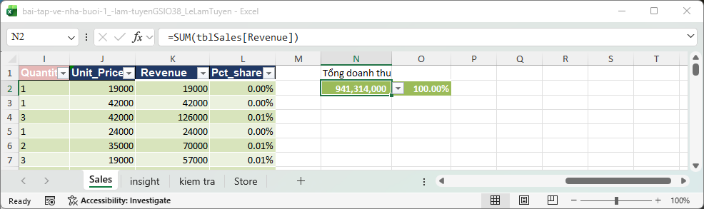
> **[CHỤP] NX01_revenue_o_tong.png** · File: `Homework/Bai_nop/bai-tap-ve-nha-buoi-1_-lam-tuyenGSIO38_LeLamTuyen.xlsx` · Sheet: `Sales` · Vùng: I1:O6 · Cần thấy: cột Revenue, ô N2 (tổng) và cột Pct_Share; chọn N2 để thanh công thức hiện `=SUM(tblSales[Revenue])`, chọn một ô Pct_Share để hiện `$N$2`.

## Điểm cần lưu ý

### 1. File nộp là bài thực hành trên lớp, chưa phải file đề (ảnh hưởng cả bài)

**Bạn đã làm:** file có **6.187 dòng** dữ liệu **Quý 1**.
**Đề yêu cầu:** `B1_BTVN_MCI_Mart_T4_2025.xlsx`, báo cáo **tháng 4/2025**, **1.919 dòng**, tổng doanh thu **296.965.000**, tổng Quantity **3.448**; sheet `De_bai` ghi đủ 8 việc và các chỉ tiêu tự kiểm tra.
**Hậu quả:** các chỉ tiêu tự kiểm tra của đề (1.919, 296.965.000, 3.448) không dùng được cho file bạn, nên điểm bên trên chỉ là tạm tính. Các lỗi cài sẵn của đề (13 dòng "Cộng", dòng tiêu đề lặp, 12 ô ngày text…) bạn chưa gặp.
**Cách xử lý:** tải lại file đề, làm theo 8 việc trong sheet `De_bai`, thao tác y như bài trên lớp, rồi nộp với tên `B1_BTVN_<HoTen>.xlsx`.

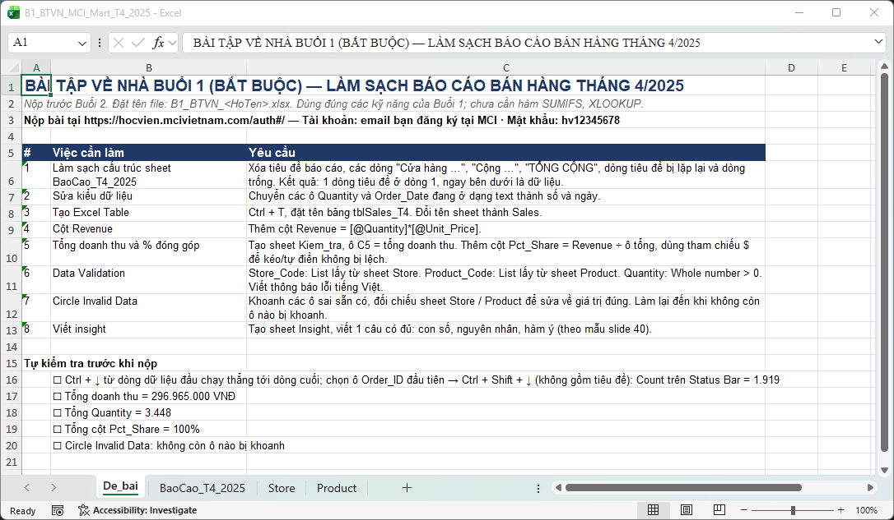
> **[CHỤP] NX02_de_bai.png** · File: `Homework/B1_BTVN_MCI_Mart_T4_2025.xlsx` · Sheet: `De_bai` · Vùng: A1:C20 · Cần thấy: tiêu đề "BÀI TẬP VỀ NHÀ BUỔI 1 (BẮT BUỘC) — LÀM SẠCH BÁO CÁO BÁN HÀNG THÁNG 4/2025", bảng 8 việc và danh sách tự kiểm tra.

### 2. Kiểu dữ liệu: còn 15 ô Quantity text và 20 ô Order_Date text (Việc 2: 0/1)

**Bạn đã làm:**
- Quantity (cột I) còn 15 ô text: I309, I479, I576, I597, I708…
- Order_Date (cột D) còn 20 ô text: D384, D410, D490, D512…

**Đáp án:** các ô này là số và ngày thật, căn phải.
**Hậu quả:** tổng Quantity hụt vì SUM bỏ qua ô text, lọc hay Pivot theo ngày sót 20 dòng.

**Cách sửa:**
1. *Quantity:* bấm ô có tam giác xanh ở góc → **Convert to Number**.
2. *Order_Date:* ở ô trống bên cạnh gõ `=DATE(RIGHT(D384,4),MID(D384,4,2),LEFT(D384,2))`, kéo cho đủ các ô, copy → chọn lại ô gốc → **Paste Special → Values** (Alt H V V). Hoặc dùng **Text to Columns → Date: DMY**. Kiểm tra ngày không bị đảo với tháng.
3. Thêm cột tạm `=ISTEXT(I2)` và `=ISTEXT(D2)`, lọc TRUE xem còn sót ô nào không, xong xóa cột tạm.

**Học lại:** **slide 29, bước 4** (`Slide_B1_HocVien.pptx`), thực hành lại trên `Practice/B1_MCI_Mart_Q1_2025_Dirty.xlsx`.

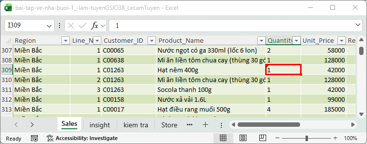
> **[CHỤP] NX03a_quantity_text_bai_ban.png** · File: `Homework/Bai_nop/bai-tap-ve-nha-buoi-1_-lam-tuyenGSIO38_LeLamTuyen.xlsx` · Sheet: `Sales` · Vùng: F307:K311 (quanh I309) · Cần thấy: I309 có tam giác xanh và căn trái; viền đỏ I309.

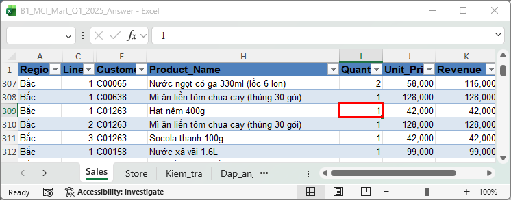
> **[CHỤP] NX03b_quantity_dap_an.png** · File: `Practice/B1_MCI_Mart_Q1_2025_Answer.xlsx` · Sheet: `Sales` · Vùng: F307:K311 · Cần thấy: Quantity căn phải, không có tam giác xanh; viền đỏ I309.

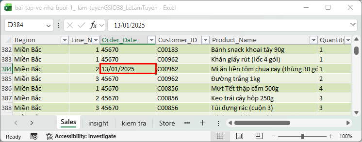
> **[CHỤP] NX04a_ngay_text_bai_ban.png** · File: `Homework/Bai_nop/bai-tap-ve-nha-buoi-1_-lam-tuyenGSIO38_LeLamTuyen.xlsx` · Sheet: `Sales` · Vùng: A382:K386 · Cần thấy: D384 căn trái (text) giữa các ô ngày căn phải; viền đỏ D384.

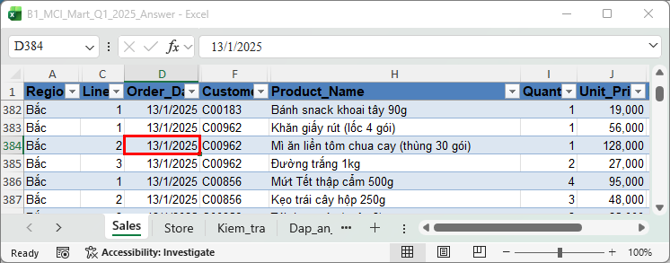
> **[CHỤP] NX04b_ngay_dap_an.png** · File: `Practice/B1_MCI_Mart_Q1_2025_Answer.xlsx` · Sheet: `Sales` · Vùng: A382:K386 · Cần thấy: D384 căn phải, là ngày thật; viền đỏ D384.

### 3. Circle Invalid Data: còn 5 ô sai (Việc 7: 0/1)

**Bạn đã làm:** file còn 5 ô sai so với đề:
- 3 ô `ST3` (E421, E771, E905): mã đúng là **ST03**.
- 2 ô Quantity âm (I397, I5337): lỗi gõ dấu, sửa thành số dương.

**Khi chạy Circle Invalid Data trên file của bạn,** vòng đỏ chỉ hiện ở 2 ô Quantity âm. Ba ô `ST3` **không** bị khoanh vì danh sách ở sheet `Store` (cột B) chép luôn cả `ST3`, Excel thấy hợp lệ. Store_Code lấy List đúng 12 mã (`Store!$A$2:$A$13`) thì cả 5 ô đều bị khoanh. Nguồn List bẩn thì Circle Invalid Data cũng bị mù.

**Chỗ tự bắt được:** tổng doanh thu của bạn là **941.314.000**, thấp hơn đáp án **941.454.000** đúng **140.000**. Slide 30 đã báo trước: "Nếu doanh thu thấp hơn đáp án khoảng 140 nghìn, nhiều khả năng bạn còn ô số lượng âm chưa sửa."
**Thêm một chỗ:** ô `E6` ghi `ST02`, dữ liệu gốc là `ST01`. Mở file Dirty đối chiếu xem có sửa nhầm không.

**Cách sửa:**
1. Sửa nguồn Store_Code về đúng 12 mã (mục 5), rồi Data → Data Validation ▾ → **Circle Invalid Data** để thấy đủ 5 vòng đỏ.
2. Sửa `ST3` → `ST03` (3 ô); sửa 2 ô âm thành số dương.
3. Chạy lại Circle Invalid Data tới khi **hết vòng đỏ**.
4. Tổng doanh thu phải ra **941.454.000**.

**Học lại:** **slide 28** và **slide 30** (`Slide_B1_HocVien.pptx`), làm trên `Demo/B1_Demo_Table_Validation.xlsx`, sheet Sales.

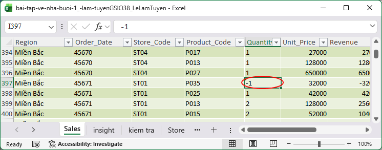
> **[CHỤP] NX05a_circle_ban.png** · File: `Homework/Bai_nop/bai-tap-ve-nha-buoi-1_-lam-tuyenGSIO38_LeLamTuyen.xlsx` · Sheet: `Sales` · Mở: Data → Data Validation ▾ → Circle Invalid Data, cuộn tới I397 · Cần thấy: vòng đỏ quanh I397 (-1).

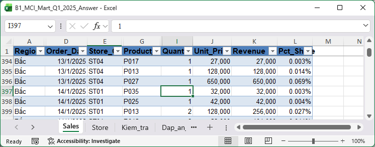
> **[CHỤP] NX05b_circle_dap_an.png** · File: `Practice/B1_MCI_Mart_Q1_2025_Answer.xlsx` · Sheet: `Sales` · Mở: Circle Invalid Data, cuộn tới I397 · Cần thấy: I397 = 1, không có vòng đỏ.

### 4. Tên Table là `tblSales`, đề yêu cầu `tblSales_T4` (Việc 3: 0,5/1)

**Bạn đã làm:** `tblSales`, đúng với bài lớp (Quý 1).
**Đề yêu cầu:** `tblSales_T4` cho file tháng 4. Hậu tố kỳ báo cáo giúp các kỳ không trùng tên khi gộp ở Buổi 4.
**Cách sửa (khi làm lại file đề):** Table Design → **Table Name** → `tblSales_T4`; sheet đổi tên `Sales`.
**Học lại:** **slide 26** (`Slide_B1_HocVien.pptx`), làm trên `Demo/B1_Demo_Table_Validation.xlsx`, sheet Sales.

### 5. Data Validation chưa theo đề (Việc 6: 0,5/1)

**Bạn đã làm:**
- Store_Code lấy List từ **sheet `Store` của bạn, cột B (6.187 dòng lặp mã)**, không phải danh sách 12 cửa hàng.
- Product_Code chưa có validation.
- Tab **Error Alert** của cả ba cột còn trống.

**Đáp án:** Store_Code List = `Store!$A$2:$A$13` (12 mã); Product_Code List từ sheet Product; Quantity Whole number > 0; cả ba có Error Alert tiếng Việt.
**Hậu quả:** danh sách 6.187 dòng lặp kéo mũi tên xổ xuống dài vô tận, không chọn nổi; Product_Code không có validation nên mã sai (P19 thay vì P019) lọt vào.

**Cách sửa:** Data Validation → Allow **List** → Source quét vùng 12 mã trong sheet Store; làm tương tự Product_Code; tab **Error Alert** điền Title và Error message tiếng Việt.
**Học lại:** **slide 27** (`Slide_B1_HocVien.pptx`), làm trên `Demo/B1_Demo_Table_Validation.xlsx`, sheet Sales.

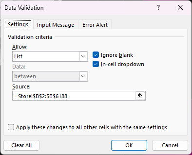
> **[CHỤP] NX06a_dv_source_ban.png** · File: `Homework/Bai_nop/bai-tap-ve-nha-buoi-1_-lam-tuyenGSIO38_LeLamTuyen.xlsx` · Sheet: `Sales` · Mở: ô Store_Code → Data → Data Validation → tab **Settings** · Cần thấy: Allow = List, Source trỏ cột B của sheet `Store` (6.187 dòng).

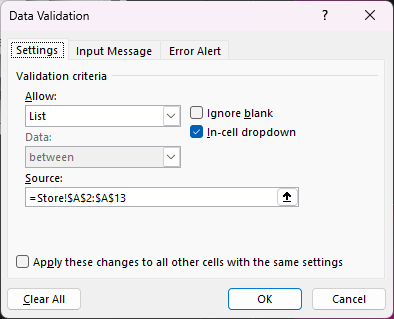
> **[CHỤP] NX06b_dv_source_dap_an.png** · File: `Practice/B1_MCI_Mart_Q1_2025_Answer.xlsx` · Sheet: `Sales` · Mở: ô Store_Code → Data Validation → tab **Settings** · Cần thấy: Source = `=Store!$A$2:$A$13`.

### 6. Ô tổng doanh thu ở sheet `kiem tra` đang gõ số tay (Việc 5: 0,5/1)

**Bạn đã làm:** `kiem tra`!C5 = **941314000** (gõ tay).
**Đáp án:** C5 là **công thức** `=SUM(tblSales[Revenue])` (hoặc `=Sales!N2`).
**Hậu quả:** sửa dữ liệu (ví dụ 2 ô âm) mà C5 không đổi theo, nên con số "kiểm tra" chỉ khớp với lần gõ chứ không khớp dữ liệu. 941.314.000 đang lệch so với 941.454.000 mà bạn không nhìn ra.

**Cách sửa:** C5 → `=SUM(tblSales[Revenue])`; sau khi sửa 2 ô âm, C5 tự ra **941.454.000**.
**Học lại:** **slide 19** (`Demo/B1_Demo_PctShare.xlsx`, sheet Demo_PctShare) và **slide 30, bước 2** (đối chiếu `Practice/B1_MCI_Mart_Q1_2025_Answer.xlsx`, sheet Kiem_tra).

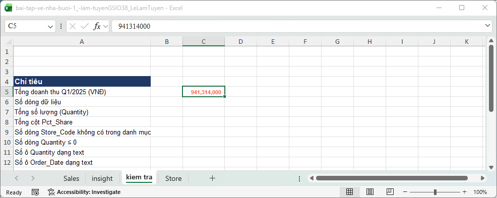
> **[CHỤP] NX07a_kiem_tra_ban.png** · File: `Homework/Bai_nop/bai-tap-ve-nha-buoi-1_-lam-tuyenGSIO38_LeLamTuyen.xlsx` · Sheet: `kiem tra` · Vùng: A1:E10 · Cần thấy: C5 = 941314000; chọn C5 để thanh công thức hiện số gõ tay (không có dấu `=`).

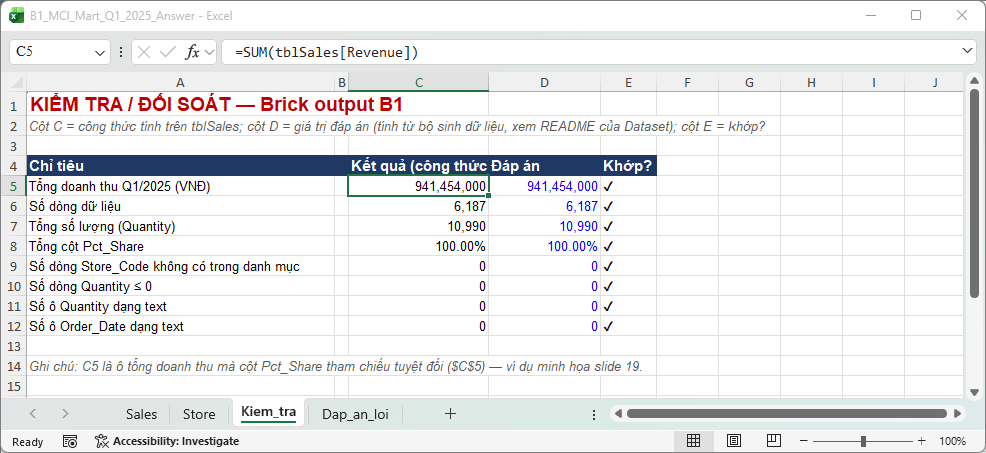
> **[CHỤP] NX07b_kiem_tra_dap_an.png** · File: `Practice/B1_MCI_Mart_Q1_2025_Answer.xlsx` · Sheet: `Kiem_tra` · Vùng: A1:E12 · Cần thấy: các dòng đối soát bằng công thức và dấu ✔; tổng doanh thu 941.454.000.

## Câu insight

Câu của bạn: *"(3 ô) Tôi đã làm sạch dữ liệu, tìm ra được 2 lỗi sai khoanh tròn, tính dc tổng doanh thu là 941,314,000 / CÓ 6187 dòng / Lỗi lớn nhất tôi phát hiện là lỗi: dãy ô trắng, tính tổng trong sheet ban đầu gây tính tổng bị sai số."*

| Thành phần | Nhận xét |
|---|---|
| **Con số** | **Có**, nhưng không khớp file bạn đang giữ: file còn **5** ô sai (3 ô ST3, 2 ô số âm) chứ không phải 2, và 941.314.000 chưa phải số đúng của bộ Q1 (đúng là 941.454.000). |
| **Nguyên nhân** | **Có** ("dãy ô trắng": dòng trống nằm giữa dữ liệu). |
| **Hàm ý** | **Chưa cụ thể.** "Tính tổng bị sai số" mà chưa nói số nào lệch bao nhiêu. |

**Viết lại theo khung slide 40** (`Slide_B1_HocVien.pptx`), con số có sẵn trong file bạn: *"File có 6.187 dòng, tôi tìm thấy ___ loại lỗi. Lỗi nguy hiểm nhất là dòng trống/ô sai nằm lẫn trong dữ liệu, nên nếu không sửa thì tổng doanh thu ra 941.314.000 thay vì 941.454.000, lệch 140.000, và mọi báo cáo theo vùng sai theo."*
**Mức tạm:** Developing.

## Việc cần làm trước Buổi 2

- [ ] Tải file đề `Homework/B1_BTVN_MCI_Mart_T4_2025.xlsx` và làm lại theo sheet `De_bai` (tháng 4/2025, 1.919 dòng).
- [ ] Đổi 15 ô Quantity text và 20 ô ngày text (làm trên bài Quý 1 cũng được, để luyện).
- [ ] Chạy Circle Invalid Data đến khi hết vòng đỏ; tổng doanh thu phải là 941.454.000.
- [ ] Đổi nguồn List của Store_Code sang danh sách 12 cửa hàng; thêm validation cho Product_Code; điền Error Alert.
- [ ] Đổi ô tổng ở `kiem tra`!C5 thành công thức.
