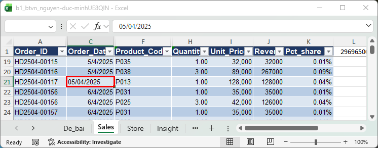
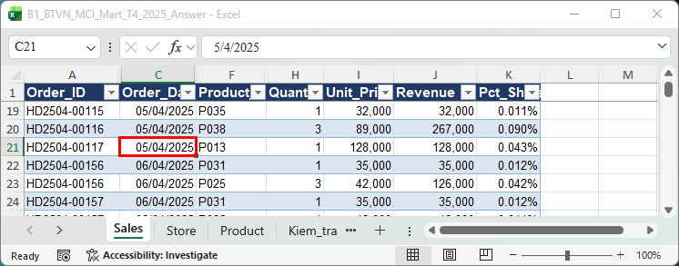
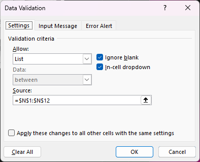
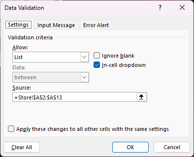
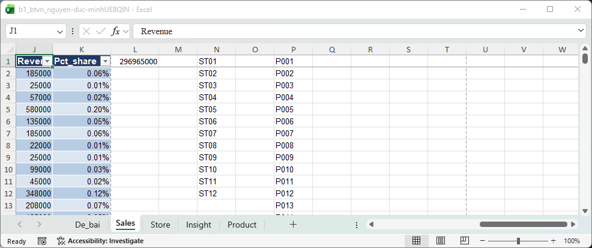
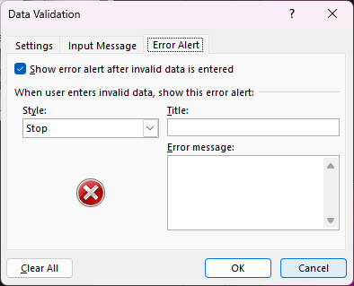
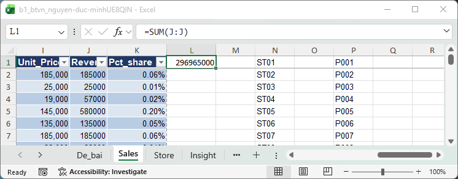
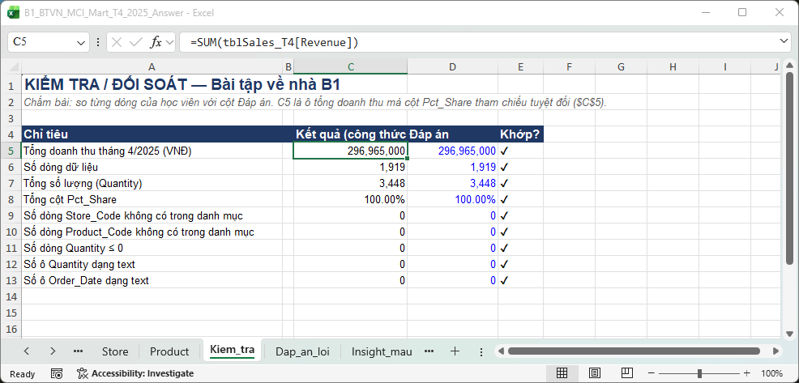

**Điểm: 6,5/10**

# Nhận xét bài tập về nhà Buổi 1 — Nguyễn Đức Minh

| # | Việc | Kết quả | Điểm |
|---|---|---|---|
| 1 | Làm sạch cấu trúc | Đạt | 1/1 |
| 2 | Kiểu dữ liệu (Quantity, Order_Date) | Một phần | 0,5/1 |
| 3 | Excel Table + tên sheet | Đạt | 1/1 |
| 4 | Cột Revenue | Đạt | 1/1 |
| 5 | Kiem_tra!C5 + Pct_Share | Một phần | 0,5/1 |
| 6 | Data Validation | Một phần | 0,5/1 |
| 7 | Circle Invalid Data | Đạt | 1/1 |
| 8 | Insight | Insight 1/3 thành phần | 1/3 |
| | **Tổng** | | **6,5/10** |

Thang điểm: việc 1–7 mỗi việc 1 điểm, việc 8 (insight) 3 điểm, mỗi thành phần đạt (con số, nguyên nhân, hàm ý) được 1 điểm; việc 1–7 Đạt được trọn điểm, Một phần được một nửa, chưa làm được 0.

## Tài liệu để xem lại

Slide nằm trong file `Slide_B1_HocVien.pptx` (thư mục Buổi 1). Các file Excel để làm lại thao tác tính từ thư mục Buổi 1.

| Slide | Nội dung | Làm lại trên file |
|---|---|---|
| 29 (bước 4) | Chuyển Quantity và Order_Date dạng text thành số và ngày | `Practice/B1_MCI_Mart_Q1_2025_Dirty.xlsx`; đối chiếu `Practice/B1_MCI_Mart_Q1_2025_Answer.xlsx`, sheet Sales |
| 27 | Data Validation: List lấy từ sheet Store / Product, tab Error Alert | `Demo/B1_Demo_Table_Validation.xlsx`, sheet Sales |
| 19 | Tham chiếu `$` (Pct_Share chia cho ô tổng) | `Demo/B1_Demo_PctShare.xlsx`, sheet Demo_PctShare |
| 30 (bước 2) | Ô tổng doanh thu + Pct_Share; ở bài về nhà ô tổng là `Kiem_tra!C5` | `Practice/B1_MCI_Mart_Q1_2025_Answer.xlsx`, sheet Kiem_tra |
| 40 | Tổng kết + câu insight (con số, nguyên nhân, hàm ý) | Sheet `Insight` trong file bạn nộp; câu mẫu ở `Homework/B1_BTVN_MCI_Mart_T4_2025_Answer.xlsx`, sheet Insight_mau |

## Đối soát nhanh với đáp án

Đáp án nằm ở `Homework/B1_BTVN_MCI_Mart_T4_2025_Answer.xlsx`, sheet `Kiem_tra`.

| Chỉ tiêu | Đáp án | File của bạn | Khớp? |
|---|---|---|---|
| Số dòng dữ liệu | 1.919 | 1.919 | ✔ |
| Tổng doanh thu | 296.965.000 | 296.965.000 | ✔ |
| Tổng Quantity | 3.448 | 3.448 | ✔ |
| Tổng Pct_Share | 100% | 100% | ✔ |
| Ô Quantity còn là text | 0 | 0 | ✔ |
| Ô Order_Date còn là text | 0 | **12** | ✘ |
| Sheet `Kiem_tra` với C5 = tổng doanh thu | Có | Chưa có (tổng ở `Sales`!L1) | ✘ |
| Nguồn List của Store_Code / Product_Code | Sheet Store / Product | Cột tự gõ N, P trên Sales | ✘ |
| Số dòng trong câu insight | 1.919 | 1920 | ✘ |

## Làm tốt

- **Bảng sạch, đúng cấu trúc:** tiêu đề ở dòng 1, 1.919 dòng dữ liệu, dòng "Cửa hàng", "Cộng", "TỔNG CỘNG", dòng lặp tiêu đề và dòng trống đã dọn hết.
- **Giá trị sửa đủ:** 10 ô Quantity text, 2 ô "ST5", 3 mã sản phẩm thiếu số 0 và 2 ô số lượng âm, không xóa dòng nào. Ba tổng 296.965.000 / 3.448 / 100% đều khớp.
- **Pct_Share khóa `$L$1`** đúng kỹ thuật tham chiếu tuyệt đối, kéo xuống không lệch, cộng lại 100%.

## Điểm cần lưu ý

### 1. Order_Date còn 12 ô là text (Việc 2: 0,5/1)

**Bạn đã làm:** cột C sheet `Sales` còn 12 ô ngày ở dạng text: C21, C39, C308, C319, C514, C659, C909, C1192, C1366, C1494, C1614, C1733. Nhìn là biết: ô **căn trái**, dạng `05/04/2025`.
**Đáp án:** 12 ô là ngày thật, căn phải, ví dụ C21 = 5/4/2025.
**Hậu quả:** lọc hoặc Pivot theo ngày (Buổi 3) sẽ **bỏ sót 12 dòng**. Tổng 296.965.000 vẫn đúng vì Revenue không phụ thuộc ngày, nên đối soát tổng không thấy gì, tới lúc lọc theo ngày mới lộ. Lỗi này im lặng.

**Cách sửa chắc tay nhất:**
1. Ở ô trống bên cạnh (ví dụ Q21) gõ `=DATE(RIGHT(C21,4),MID(C21,4,2),LEFT(C21,2))`. Chuỗi `05/04/2025` tách thành 2025, 04, 05, ra **5 tháng 4**.
2. Kéo cho đủ 12 ô, copy, chọn lại ô gốc ở cột C → **Paste Special → Values** (Alt H V V).
3. Định dạng Short Date, xóa cột phụ.
4. Hoặc: chọn các ô → **Data → Text to Columns → Next → Next → Date: DMY → Finish**.
5. Kiểm tra: ngày `05/04` phải ra 5 tháng 4.

**Học lại:** **slide 29, bước 4** (`Slide_B1_HocVien.pptx`), thực hành lại trên `Practice/B1_MCI_Mart_Q1_2025_Dirty.xlsx`.

> **[CHỤP] NX01a_ngay_text_bai_ban.png** · File: `Homework/Bai_nop/b1_btvn_nguyen-duc-minhUE8QIN.xlsx` · Sheet: `Sales` · Vùng: A19:K23 · Cần thấy: C21 căn trái giữa các ô căn phải; viền đỏ C21; chọn C21 để thanh công thức hiện `05/04/2025`.

> **[CHỤP] NX01b_ngay_dap_an.png** · File: `Homework/B1_BTVN_MCI_Mart_T4_2025_Answer.xlsx` · Sheet: `Sales` · Vùng: A19:K23 · Cần thấy: C21 căn phải, là ngày thật; viền đỏ C21.

### 2. List lấy từ chỗ khác với đề, và chưa có thông báo lỗi (Việc 6: 0,5/1)

**Bạn đã làm:**
- Store_Code: Source = `$N$1:$N$12`; Product_Code: Source = `$P$1:$P$40`. Hai cột này bạn gõ tay ngay trên sheet `Sales`.
- Tab **Error Alert** của cả ba cột (Store_Code, Product_Code, Quantity) còn trống.

**Đề yêu cầu:** List lấy từ **sheet Store và Product**: `=Store!$A$2:$A$13`, `=Product!$A$2:$A$41`.
**Vì sao quan trọng:** danh sách gõ tay không đi theo danh mục gốc. Có cửa hàng hay sản phẩm mới trong sheet Store/Product thì validation của bạn vẫn dùng danh sách cũ. Hai cột phụ N, P (chỉ 12 và 40 ô lẻ) còn nằm trong vùng dữ liệu, làm bảng hết sạch.

**Cách sửa:**
1. Chọn cột Store_Code → Data → Data Validation → Settings → Allow: **List** → Source: bấm biểu tượng chọn vùng rồi quét `Store!A2:A13` → OK. Tương tự Product_Code với `Product!A2:A41`.
2. Tab **Error Alert**: tick **Show error alert…**, Style **Stop**, nhập Title và Error message tiếng Việt cho cả ba cột.
3. Xóa các cột phụ N, P khi không còn dùng.
4. Chạy lại **Circle Invalid Data**, không còn ô nào khoanh đỏ là xong.

**Học lại:** **slide 27** (`Slide_B1_HocVien.pptx`), làm trên `Demo/B1_Demo_Table_Validation.xlsx`, sheet Sales, cột Store_Code ("Source trỏ tới danh sách 12 mã trong sheet Store").

> **[CHỤP] NX02a_dv_source_ban.png** · File: `Homework/Bai_nop/b1_btvn_nguyen-duc-minhUE8QIN.xlsx` · Sheet: `Sales` · Mở: ô Store_Code → Data → Data Validation → tab **Settings** · Cần thấy: Allow = List, Source = `=$N$1:$N$12`.

> **[CHỤP] NX02b_dv_source_dap_an.png** · File: `Homework/B1_BTVN_MCI_Mart_T4_2025_Answer.xlsx` · Sheet: `Sales` · Mở: ô Store_Code → Data Validation → tab **Settings** · Cần thấy: Source = `=Store!$A$2:$A$13`.

> **[CHỤP] NX03_cot_phu_N_P.png** · File: `Homework/Bai_nop/b1_btvn_nguyen-duc-minhUE8QIN.xlsx` · Sheet: `Sales` · Vùng: J1:P14 · Cần thấy: danh sách 12 mã ở cột N và các mã sản phẩm ở cột P nằm cạnh bảng.

> **[CHỤP] NX04_error_alert_trong.png** · Cùng file, cột Quantity → Data Validation → tab **Error Alert** · Cần thấy: Title và Error message trống.

### 3. Chưa có sheet `Kiem_tra` (Việc 5: 0,5/1)

**Bạn đã làm:** tổng doanh thu đặt ở `Sales`!L1 (`=SUM(J:J)`); Pct_Share dùng `$L$1`, đúng kỹ thuật `$`.
**Đề yêu cầu:** sheet **`Kiem_tra`**, ô **C5** = `SUM(tblSales_T4[Revenue])`, và Pct_Share = Revenue ÷ `Kiem_tra!$C$5`.
**Vì sao đề đòi đúng vị trí:** các buổi sau và bảng đối soát của lớp đều đọc tổng ở `Kiem_tra!C5`. Ô tổng đặt ngay trên sheet dữ liệu thì có hai chỗ yếu: `SUM(J:J)` cộng cả cột nên dễ lẫn ô khác, còn L1 nằm trong vùng dữ liệu, sắp xếp hay lọc là xáo trộn.

**Cách sửa:**
1. Thêm sheet mới, đặt tên `Kiem_tra`.
2. Ô C5: `=SUM(tblSales_T4[Revenue])` (dùng tên bảng thay vì `J:J`).
3. Cột Pct_Share: `=[@Revenue]/Kiem_tra!$C$5`, cộng cột phải ra 100%.
4. Xóa ô L1 cũ.

**Học lại:** **slide 19** (`Demo/B1_Demo_PctShare.xlsx`, sheet Demo_PctShare: ô tổng B5 và `$B$5`) và **slide 30, bước 2** (đối chiếu `Practice/B1_MCI_Mart_Q1_2025_Answer.xlsx`, sheet Kiem_tra).

> **[CHỤP] NX05a_o_tong_L1.png** · File: `Homework/Bai_nop/b1_btvn_nguyen-duc-minhUE8QIN.xlsx` · Sheet: `Sales` · Vùng: I1:M4 · Cần thấy: ô L1 = 296.965.000; chọn L1 để thanh công thức hiện `=SUM(J:J)`; chọn một ô Pct_Share để hiện `$L$1`.

> **[CHỤP] NX05b_kiem_tra_dap_an.png** · File: `Homework/B1_BTVN_MCI_Mart_T4_2025_Answer.xlsx` · Sheet: `Kiem_tra` · Vùng: A1:E13 · Cần thấy: C5 `=SUM(tblSales_T4[Revenue])`, các dòng đối soát và dấu ✔.

## Câu insight

Câu của bạn: *"File case có 1920 dòng, tổng doanh thu 296965000 VNĐ; tổng quantity 3448; tổng pct_Share=100%, tìm thấy 3 loại lỗi dữ liệu"*

| Thành phần | Nhận xét |
|---|---|
| **Con số** | **Có, đúng một phần.** 296.965.000 và 3.448 đúng. 1920 đã tính cả dòng tiêu đề, dòng dữ liệu là **1.919**. "3 loại lỗi" cần đếm lại: bạn xử lý cấu trúc, kiểu dữ liệu, mã sai, số âm, tức là hơn 3 nhóm. |
| **Nguyên nhân** | **Chưa có.** Câu chưa nói lỗi nào nguy hiểm nhất. |
| **Hàm ý** | **Chưa có.** Không sửa thì con số nào sai, câu chưa nói. |

Câu này đang đọc lại các số đối soát, chưa thành insight: người đọc biết file "sạch" mà không biết **lỗi gì, hậu quả gì**.
**Cách sửa:** chọn một lỗi, nêu con số trước và sau khi sửa, kết bằng "nên nếu không sửa thì …" (khung **slide 40**, `Slide_B1_HocVien.pptx`). Câu mẫu (sheet Insight_mau): *"… Lỗi nguy hiểm nhất là 13 dòng cộng nằm lẫn trong dữ liệu, nên nếu không sửa thì SUM cột Quantity ra 10.309 thay vì 3.448, gần gấp ba."*
Bài của bạn có sẵn lỗi ngày text để viết: *"… 12 ô Order_Date là text, nên nếu không sửa thì lọc theo ngày bỏ sót 12 dòng giao dịch."*
**Mức hiện tại:** đọc lại con số (Emerging).

> **[CHỤP] NX06_insight_mau.png** · File: `Homework/B1_BTVN_MCI_Mart_T4_2025_Answer.xlsx` · Sheet: `Insight_mau` · Vùng: A1:A5 · Cần thấy: câu mẫu (bật Wrap Text, kéo rộng cột A).

## Việc cần làm trước Buổi 2

- [ ] Đổi 12 ô Order_Date text thành ngày thật.
- [ ] Đổi nguồn List của Store_Code và Product_Code sang sheet Store và Product; điền Error Alert cho cả ba cột.
- [ ] Tạo sheet `Kiem_tra` với C5 = `SUM(tblSales_T4[Revenue])`; trỏ Pct_Share về `Kiem_tra!$C$5`.
- [ ] Viết lại câu insight: số dòng 1.919, một lỗi cụ thể, hậu quả bằng con số.
