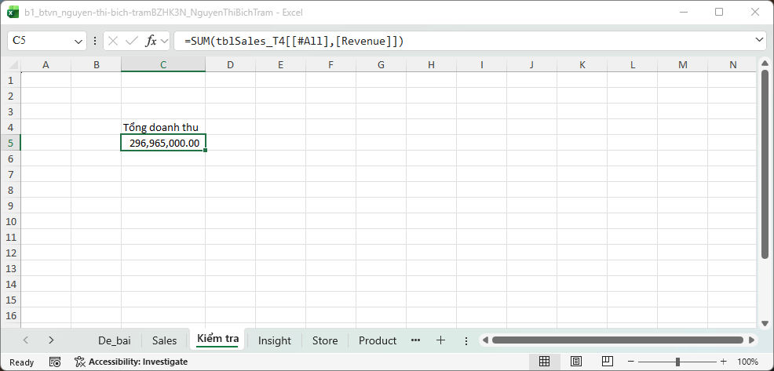
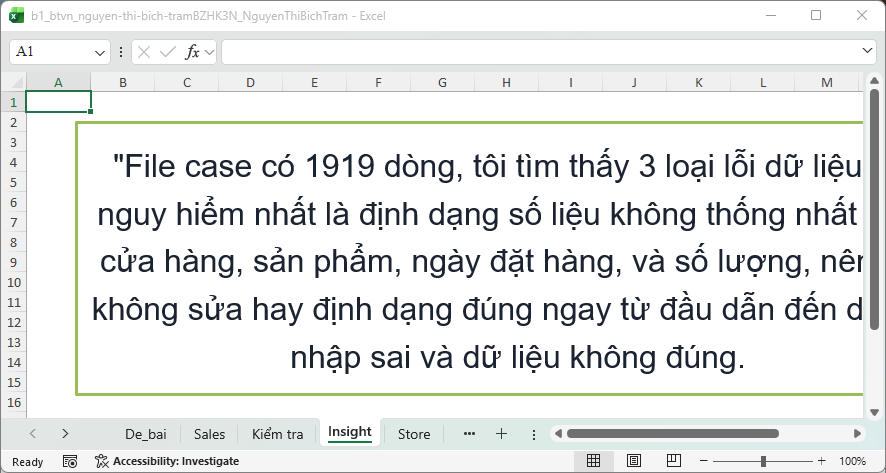
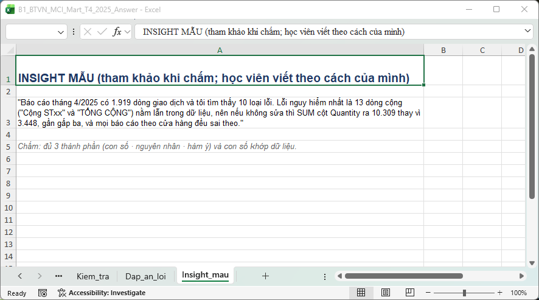
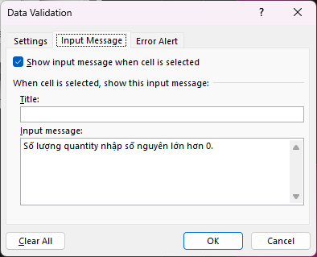
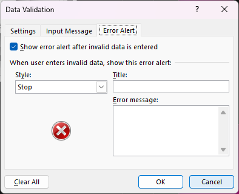
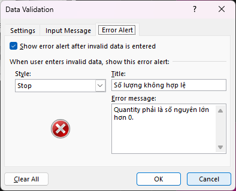
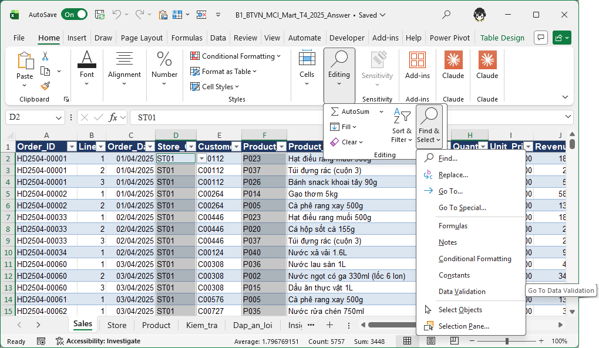

**Điểm: 9,5/10**

# Nhận xét bài tập về nhà Buổi 1 — Nguyễn Thị Bích Trâm

| # | Việc | Kết quả | Điểm |
|---|---|---|---|
| 1 | Làm sạch cấu trúc | Đạt | 1/1 |
| 2 | Kiểu dữ liệu (Quantity, Order_Date) | Đạt | 1/1 |
| 3 | Excel Table + tên sheet | Đạt | 1/1 |
| 4 | Cột Revenue | Đạt | 1/1 |
| 5 | Kiem_tra!C5 + Pct_Share | Đạt | 1/1 |
| 6 | Data Validation | Một phần | 0,5/1 |
| 7 | Circle Invalid Data | Đạt | 1/1 |
| 8 | Insight | Đủ 3 thành phần (viết trong text box) | 3/3 |
| | **Tổng** | | **9,5/10** |

Thang điểm: việc 1–7 mỗi việc 1 điểm, việc 8 (insight) 3 điểm, mỗi thành phần đạt (con số, nguyên nhân, hàm ý) được 1 điểm; việc 1–7 Đạt được trọn điểm, Một phần được một nửa, chưa làm được 0.

## Tài liệu để xem lại

Slide nằm trong file `Slide_B1_HocVien.pptx` (thư mục Buổi 1). Các file Excel để làm lại thao tác tính từ thư mục Buổi 1.

| Slide | Nội dung | Làm lại trên file |
|---|---|---|
| 27 | Data Validation, tab Error Alert | `Demo/B1_Demo_Table_Validation.xlsx`, sheet Sales |
| 28 | Circle Invalid Data | `Demo/B1_Demo_Table_Validation.xlsx`, sheet Sales |
| 40 | Tổng kết + câu insight (con số, nguyên nhân, hàm ý) | Sheet `Insight` trong file bạn nộp; câu mẫu ở `Homework/B1_BTVN_MCI_Mart_T4_2025_Answer.xlsx`, sheet Insight_mau |

## Đối soát nhanh với đáp án

Đáp án nằm ở `Homework/B1_BTVN_MCI_Mart_T4_2025_Answer.xlsx`, sheet `Kiem_tra`.

| Chỉ tiêu | Đáp án | File của bạn | Khớp? |
|---|---|---|---|
| Số dòng dữ liệu | 1.919 | 1.919 | ✔ |
| Tổng doanh thu | 296.965.000 | 296.965.000 | ✔ |
| Tổng Quantity | 3.448 | 3.448 | ✔ |
| Tổng Pct_Share | 100% | 100% | ✔ |
| Ô Quantity / Order_Date còn là text | 0 / 0 | 0 / 0 | ✔ |
| Thông báo lỗi tiếng Việt ở tab Error Alert | Có, cả 3 cột | Chưa có | ✘ |
| Sheet Insight | 1 câu đủ 3 phần | Có 1 câu, đủ 3 phần (trong text box) | ✔ |

## Làm tốt

- **Phần dữ liệu làm rất chắc.** Bảng sạch 1.919 dòng, 10 ô Quantity và 12 ô ngày đổi đúng (không đảo ngày/tháng), 7 ô sai mã và số âm được sửa mà không mất dòng nào. Mọi chỉ tiêu đối soát ở bảng trên đều khớp.
- **Công thức đúng kỹ thuật.** `Kiểm tra`!C5 là công thức tổng doanh thu, Pct_Share khóa `$C$5` nên kéo xuống không lệch.
- **Biết hỏi.** Bạn để lại hai câu về Validation và Circle Invalid Data trong sheet `Question`, thói quen này đáng giữ (trả lời ở cuối bài).

> **[CHỤP] NX01_bang_sach_doi_soat.png** · File: `Homework/Bai_nop/b1_btvn_nguyen-thi-bich-tramBZHK3N_NguyenThiBichTram.xlsx` · Sheet: `Kiểm tra` · Vùng: A1:E13 · Cần thấy: ô C5 (công thức tổng doanh thu) và các dòng đối soát cho thấy 296.965.000 / 1.919 / 3.448 / 100%; bấm vào C5 để thanh công thức hiện `=SUM(...)`.

## Điểm cần lưu ý

### 1. Câu insight đủ ý, nhưng nên viết trong ô và thêm con số so sánh (Việc 8: 3/3)

**Bạn đã làm:** sheet `Insight` có một câu, đặt trong **text box** (ô A2): *"File case có 1919 dòng, tôi tìm thấy 3 loại lỗi dữ liệu. Lỗi nguy hiểm nhất là định dạng số liệu không thống nhất ở cột cửa hàng, sản phẩm, ngày đặt hàng, và số lượng, nên nếu không sửa hay định dạng đúng ngay từ đầu dẫn đến dữ liệu nhập sai và dữ liệu không đúng."*
**Đạt:** có con số (1.919 dòng, đúng), có nguyên nhân (định dạng không thống nhất), có hàm ý "nếu không sửa thì …". Việc này bạn được trọn điểm.
**Nên cải thiện:**
- **Viết trong ô, bỏ text box.** Chữ trong text box không thuộc ô nào, nên không tìm, không lọc, không tham chiếu được, công cụ kiểm tra tự động cũng không đọc ra. Gõ thẳng vào ô A1 và bật Wrap Text.
- **Hàm ý cần một con số.** "Dữ liệu nhập sai" thì chưa biết sai bao nhiêu, còn câu mẫu nói luôn SUM cột Quantity ra 10.309 thay vì 3.448, gần gấp ba.
- **Số loại lỗi:** bạn ghi 3, file đề cài sẵn 10 (sheet `Dap_an_loi` trong file đáp án). Không trừ điểm, nhưng nên ghi "ít nhất" hoặc đếm lại.
**Câu mẫu** (sheet Insight_mau trong file đáp án): *"Báo cáo tháng 4/2025 có 1.919 dòng giao dịch và tôi tìm thấy 10 loại lỗi. Lỗi nguy hiểm nhất là 13 dòng cộng ("Cộng STxx" và "TỔNG CỘNG") nằm lẫn trong dữ liệu, nên nếu không sửa thì SUM cột Quantity ra 10.309 thay vì 3.448, gần gấp ba, và mọi báo cáo theo cửa hàng đều sai theo."*

> **[CHỤP] NX02a_insight_trong.png** · File: `Homework/Bai_nop/b1_btvn_nguyen-thi-bich-tramBZHK3N_NguyenThiBichTram.xlsx` · Sheet: `Insight` · Vùng: A1:E8 · Cần thấy: text box chứa câu insight của bạn.

> **[CHỤP] NX02b_insight_mau.png** · File: `Homework/B1_BTVN_MCI_Mart_T4_2025_Answer.xlsx` · Sheet: `Insight_mau` · Vùng: A1:A5 · Cần thấy: câu mẫu có đủ con số, nguyên nhân, hàm ý (bật Wrap Text, kéo rộng cột A cho đọc được cả câu).

### 2. Data Validation chưa có thông báo lỗi tiếng Việt (Việc 6: 0,5/1)

**Bạn đã làm:** ở cột Quantity bạn viết "Số lượng quantity nhập số nguyên lớn hơn 0.", nhưng dòng này nằm ở tab **Input Message**, tức là lời nhắc hiện **khi bấm vào ô**. Store_Code và Product_Code chưa có thông báo ở tab nào.
**Đề yêu cầu:** thông báo hiện **khi nhập sai**, ở tab **Error Alert** (việc 6: "Viết thông báo lỗi tiếng Việt").
**Khác nhau ở thời điểm:** Input Message nhắc *trước* khi nhập, Error Alert chặn *sau* khi nhập sai. Hiện giờ gõ "abc" vào Quantity chỉ ra cửa sổ lỗi tiếng Anh mặc định của Excel.

**Cách sửa (làm cho cả ba cột):**
1. Chọn cột (ví dụ Quantity) → **Data → Data Validation**.
2. Sang tab **Error Alert**, tick **Show error alert after invalid data is entered**.
3. Style chọn **Stop**; Title ghi "Số lượng không hợp lệ"; Error message ghi "Chỉ nhập số nguyên lớn hơn 0".
4. Lặp lại cho Store_Code (List từ sheet Store, thông báo: "Chỉ nhập mã trong danh sách cửa hàng ST01–ST12") và Product_Code (List từ sheet Product).
5. Nhập thử một giá trị sai, cửa sổ lỗi phải hiện đúng chữ bạn viết.

**Học lại:** **slide 27** (`Slide_B1_HocVien.pptx`), làm trên `Demo/B1_Demo_Table_Validation.xlsx`, sheet Sales. TIP trong slide: tab Error Alert cho phép tự viết thông báo lỗi bằng tiếng Việt.

> **[CHỤP] NX03a_dv_input_message.png** · File: `Homework/Bai_nop/b1_btvn_nguyen-thi-bich-tramBZHK3N_NguyenThiBichTram.xlsx` · Sheet: `Sales` · Mở: chọn cột Quantity → Data → Data Validation → tab **Input Message** · Cần thấy: hộp thoại có chữ "Số lượng quantity nhập số nguyên lớn hơn 0." và tên tab đang chọn.

> **[CHỤP] NX03b_dv_error_alert_trong.png** · Cùng file, cột Quantity, tab **Error Alert** · Cần thấy: ô "Show error alert after invalid data is entered" chưa tick / Title và Error message để trống.

> **[CHỤP] NX03c_dv_error_alert_dap_an.png** · File: `Homework/B1_BTVN_MCI_Mart_T4_2025_Answer.xlsx` · Sheet: `Sales` · Mở: cột Quantity → Data Validation → tab **Error Alert** · Cần thấy: ô đã tick, Style Stop, có Title và Error message tiếng Việt.

## Câu insight

Câu của bạn có đủ ba phần: **con số** (1.919 dòng), **nguyên nhân** (định dạng không thống nhất), **hàm ý** "nếu không sửa thì …". Thêm **con số trước và sau khi sửa** vào phần hàm ý là câu sẽ có sức nặng, ví dụ: *"…nên nếu không sửa thì tổng ___ ra ___ thay vì ___."* Còn câu thì gõ vào **ô**, đừng để trong text box.

## Trả lời hai câu hỏi trong sheet `Question`

**1. "Chọn lại được vùng đã validated không?"** Được.
- Muốn **chọn** mọi ô đang có validation: **Home → Find & Select → Data Validation**.
- Muốn **đổi quy tắc** cho cả vùng: bấm vào một ô, mở Data Validation, đổi quy tắc và tick **Apply these changes to all other cells with the same settings**.

> **[CHỤP] NX04_find_select_data_validation.png** · File: `Homework/B1_BTVN_MCI_Mart_T4_2025_Answer.xlsx` · Sheet: `Sales` · Cần thấy: menu Home → Find & Select đang mở, mục Data Validation được trỏ; các ô Quantity/Store_Code/Product_Code đã được chọn (nền xám) ở phía sau.

**2. "Filter được Circle Invalid Data không?"** Không. Vòng đỏ chỉ là hình vẽ tạm trên màn hình, không phải định dạng của ô nên Filter không thấy. Muốn lọc các ô sai:
- Thêm cột kiểm tra, ví dụ `=COUNTIF(Store!$A$2:$A$13,[@Store_Code])=0`, rồi lọc **TRUE**; hoặc
- Tô màu bằng Conditional Formatting rồi **Filter by Color**.

Thao tác Circle Invalid Data gốc xem ở **slide 28**, `Demo/B1_Demo_Table_Validation.xlsx`, sheet Sales.

## Việc cần làm trước Buổi 2

- [ ] Chuyển câu insight từ text box vào ô A1 của sheet `Insight`, thêm con số trước/sau khi sửa vào phần hàm ý.
- [ ] Điền tab **Error Alert** cho Quantity, Store_Code, Product_Code rồi thử nhập sai để kiểm tra.
- [ ] Mở `Practice/B1_MCI_Mart_Q1_2025_Answer.xlsx` (file khởi đầu Buổi 2) để làm quen sheet Kiem_tra.
