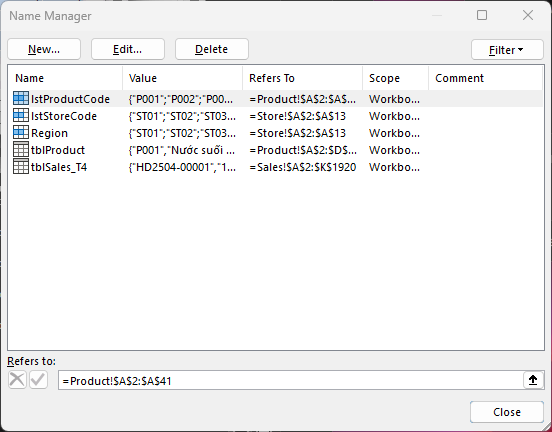
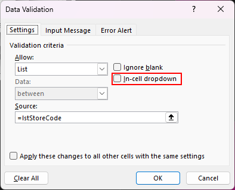
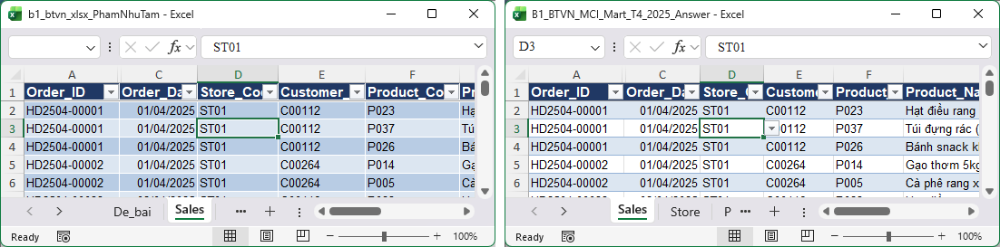
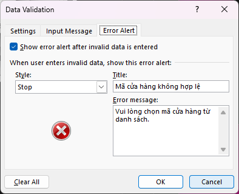
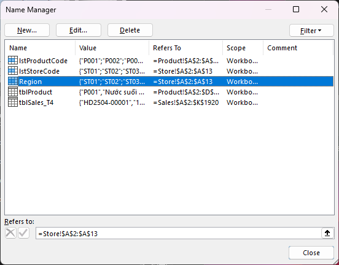

**Điểm: 9,5/10**

# Nhận xét bài tập về nhà Buổi 1 — Phạm Như Tâm

| # | Việc | Kết quả | Điểm |
|---|---|---|---|
| 1 | Làm sạch cấu trúc | Đạt | 1/1 |
| 2 | Kiểu dữ liệu (Quantity, Order_Date) | Đạt | 1/1 |
| 3 | Excel Table + tên sheet | Đạt | 1/1 |
| 4 | Cột Revenue | Đạt | 1/1 |
| 5 | Kiem_tra!C5 + Pct_Share | Đạt | 1/1 |
| 6 | Data Validation | Một phần | 0,5/1 |
| 7 | Circle Invalid Data | Đạt | 1/1 |
| 8 | Insight | Insight 3/3 thành phần | 3/3 |
| | **Tổng** | | **9,5/10** |

Thang điểm: việc 1–7 mỗi việc 1 điểm, việc 8 (insight) 3 điểm, mỗi thành phần đạt (con số, nguyên nhân, hàm ý) được 1 điểm; việc 1–7 Đạt được trọn điểm, Một phần được một nửa, chưa làm được 0.

## Tài liệu để xem lại

Slide nằm trong file `Slide_B1_HocVien.pptx` (thư mục Buổi 1). Các file Excel để làm lại thao tác tính từ thư mục Buổi 1.

| Slide | Nội dung | Làm lại trên file |
|---|---|---|
| 27 | Data Validation: List, Whole number, tab Error Alert | `Demo/B1_Demo_Table_Validation.xlsx`, sheet Sales |
| 40 | Tổng kết + câu insight (con số, nguyên nhân, hàm ý) | Sheet `Insight` trong file bạn nộp; câu mẫu ở `Homework/B1_BTVN_MCI_Mart_T4_2025_Answer.xlsx`, sheet Insight_mau |

## Đối soát nhanh với đáp án

Đáp án nằm ở `Homework/B1_BTVN_MCI_Mart_T4_2025_Answer.xlsx`, sheet `Kiem_tra`.

| Chỉ tiêu | Đáp án | File của bạn | Khớp? |
|---|---|---|---|
| Số dòng dữ liệu | 1.919 | 1.919 | ✔ |
| Tổng doanh thu | 296.965.000 | 296.965.000 | ✔ |
| Tổng Quantity | 3.448 | 3.448 | ✔ |
| Tổng Pct_Share | 100% | 100% | ✔ |
| Ô Quantity / Order_Date còn là text | 0 / 0 | 0 / 0 | ✔ |
| Mũi tên xổ xuống ở Store_Code, Product_Code | Hiện | Ẩn | ✘ |
| Error Alert của Product_Code | Có | Chưa có | ✘ |

## Làm tốt

- **Số liệu đối soát khớp hết:** 1.919 dòng, doanh thu 296.965.000, Quantity 3.448, Pct_Share cộng lại đúng 100%. 10 ô Quantity và 12 ô ngày đã về đúng kiểu, 7 ô sai mã và số âm được sửa, không mất dòng nào.
- **Đặt tên vùng `lstStoreCode`, `lstProductCode`** trỏ vào sheet Store và Product làm nguồn List. Gọn hơn gõ địa chỉ `$A$2:$A$13`, sau này đổi danh sách cũng dễ. Buổi 1 chưa yêu cầu tới mức này.
- **`Kiem tra`!C5 là công thức**, và Pct_Share khóa đúng `$C$5`.
- **Câu insight đủ ba thành phần** (xem phần cuối).

> **[CHỤP] NX01_name_manager.png** · File: `Homework/Bai_nop/b1_btvn_xlsx_PhamNhuTam.xlsx` · Mở: Formulas → Name Manager · Cần thấy: danh sách tên `lstStoreCode`, `lstProductCode` kèm cột "Refers To" trỏ vào `Store!` và `Product!`; thấy luôn tên `Region` ở dòng dưới (xem mục 3).

## Điểm cần lưu ý

### 1. Hai ô List đang ẩn mũi tên chọn (Việc 6: 0,5/1)

**Bạn đã làm:** Store_Code và Product_Code có validation List trỏ đúng nguồn, nhưng ô **In-cell dropdown** bị bỏ tick.
**Hậu quả:** bấm vào ô không thấy mũi tên, người nhập phải tự gõ mã. Validation vẫn chặn mã sai, nhưng List sinh ra để chọn chứ không để gõ, và ST3, P19 trong đề chính là kiểu mã gõ nhầm.
**Đáp án:** cả hai cột hiện mũi tên khi chọn ô.

**Cách sửa:**
1. Chọn cột Store_Code → **Data → Data Validation → Settings**.
2. Tick **In-cell dropdown** → OK.
3. Làm tương tự cho Product_Code.
4. Bấm thử một ô: mũi tên phải hiện bên phải ô.

**Học lại:** **slide 27** (`Slide_B1_HocVien.pptx`), làm trên `Demo/B1_Demo_Table_Validation.xlsx`, sheet Sales, cột Store_Code: "Source trỏ tới danh sách 12 mã … từ giờ ô đó có một mũi tên xổ xuống".

> **[CHỤP] NX02a_dropdown_chua_tick.png** · File: `Homework/Bai_nop/b1_btvn_xlsx_PhamNhuTam.xlsx` · Sheet: `Sales` · Mở: chọn một ô Store_Code → Data → Data Validation → tab **Settings** · Cần thấy: Allow = List, Source = `=lstStoreCode`, ô **In-cell dropdown** để trống (khoanh đỏ ô này).

> **[CHỤP] NX02b_dropdown_dap_an.png** · File: `Homework/B1_BTVN_MCI_Mart_T4_2025_Answer.xlsx` · Sheet: `Sales` · Mở: ô Store_Code → Data Validation → tab **Settings** · Cần thấy: Source = `=Store!$A$2:$A$13`, ô **In-cell dropdown** đã tick.

> **[CHỤP] NX03_mui_ten_o_list.png** · Chụp hai ảnh ghép cạnh nhau: (trái) file bạn nộp, sheet `Sales`, chọn một ô Store_Code, **không** thấy mũi tên; (phải) `Homework/B1_BTVN_MCI_Mart_T4_2025_Answer.xlsx`, sheet `Sales`, chọn ô Store_Code, thấy mũi tên xổ xuống. Vùng chụp A1:E8 mỗi bên.

### 2. Product_Code chưa có thông báo lỗi (Việc 6)

**Bạn đã làm:** Store_Code và Quantity có thông báo tiếng Việt ở tab **Error Alert**, Product_Code thì chưa.
**Cách sửa:** Data → Data Validation → tab **Error Alert** → tick **Show error alert after invalid data is entered** → Style **Stop** → Title "Mã sản phẩm không hợp lệ" → Error message "Chỉ nhập mã có trong danh sách sản phẩm (P001–P040)" → OK.
**Học lại:** TIP ở **slide 27**, cùng file `Demo/B1_Demo_Table_Validation.xlsx`.

> **[CHỤP] NX04a_product_error_alert_trong.png** · File: `Homework/Bai_nop/b1_btvn_xlsx_PhamNhuTam.xlsx` · Sheet: `Sales` · Mở: ô Product_Code → Data Validation → tab **Error Alert** · Cần thấy: Title và Error message trống.

> **[CHỤP] NX04b_store_error_alert_tot.png** · Cùng file, ô Store_Code → Data Validation → tab **Error Alert** · Cần thấy: Title và Error message tiếng Việt của bạn.

### 3. Một tên vùng đặt chưa đúng nội dung (không trừ điểm)

**Bạn đã làm:** tên `Region` đang trỏ `Store!$A$2:$A$13`, tức là danh sách **mã cửa hàng**, không phải miền.
**Vì sao nên sửa:** sang Buổi 2, `Region` là một cột thật của bảng (tra từ sheet Store). Tên vùng trùng tên cột sẽ làm bạn, và người mở file sau bạn, đọc công thức là nhầm.
**Cách sửa:** Formulas → Name Manager → chọn `Region` → Edit → đổi tên thành `lstStoreCode2` (hoặc xóa nếu không dùng) → OK.

> **[CHỤP] NX05_name_region.png** · File: `Homework/Bai_nop/b1_btvn_xlsx_PhamNhuTam.xlsx` · Mở: Formulas → Name Manager, chọn dòng `Region` · Cần thấy: cột Refers To = `=Store!$A$2:$A$13`, hộp "Refers to" bên dưới hiện cùng giá trị.

## Câu insight

Câu của bạn: *"File case có 1.919 dòng, tôi tìm thấy 3 loại lỗi dữ liệu; lỗi nguy hiểm nhất là Quantity âm (-2), vì làm sai Revenue, nên cần kiểm tra và sửa dữ liệu trước khi phân tích."*

| Thành phần | Nhận xét |
|---|---|
| **Con số** | **Có và đúng.** 1.919 dòng và hai ô Quantity âm (-2) khớp file. Chỗ "3 loại lỗi" nên đếm lại: bạn đã xử lý cấu trúc, kiểu dữ liệu, mã sai, số âm, tức là hơn 3 nhóm, và `Dap_an_loi` liệt kê 10 loại. |
| **Nguyên nhân** | **Có.** Quantity âm làm sai Revenue, đúng. |
| **Hàm ý** | **Có**, nhưng "cần kiểm tra và sửa" thì ai cũng viết được. |

**Thêm một con số so sánh là câu sẽ có sức nặng.** Bạn thử tính: giữ nguyên hai ô âm thì tổng Quantity và doanh thu lệch bao nhiêu so với 3.448 và 296.965.000? Điền vào khung: *"… nên nếu không sửa thì tổng Quantity ra ___ thay vì 3.448 và doanh thu lệch ___ đồng."* Câu mẫu ở sheet Insight_mau cũng đặt hai con số "ra ... thay vì ..." cạnh nhau như vậy.

**Mức hiện tại:** Competent, đủ ba thành phần và con số khớp. Có thêm số so sánh thì lên mức vững. Khung câu ở **slide 40** (`Slide_B1_HocVien.pptx`).

## Việc cần làm trước Buổi 2

- [ ] Tick **In-cell dropdown** cho Store_Code và Product_Code.
- [ ] Điền tab **Error Alert** cho Product_Code.
- [ ] Đổi hoặc xóa tên vùng `Region` trong Name Manager.
- [ ] Tự tính độ lệch tổng Quantity và doanh thu nếu giữ hai ô âm, rồi bổ sung vào câu insight.
