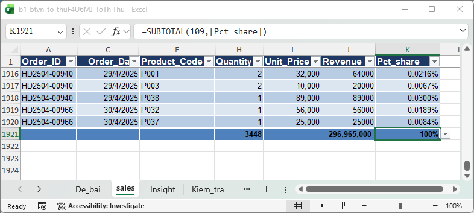
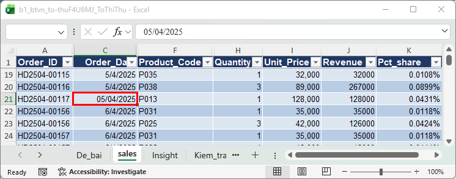
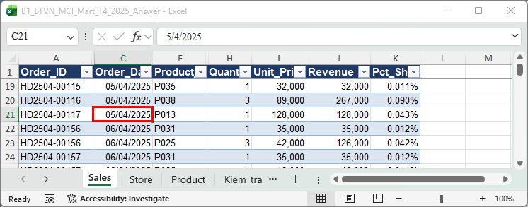
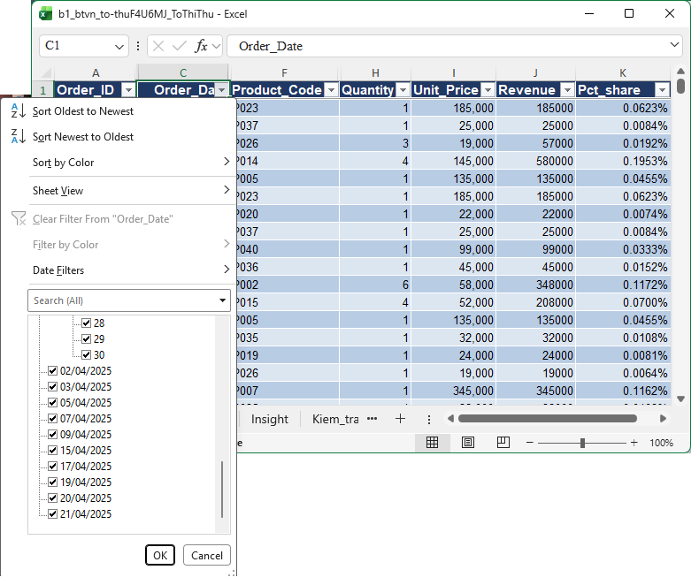
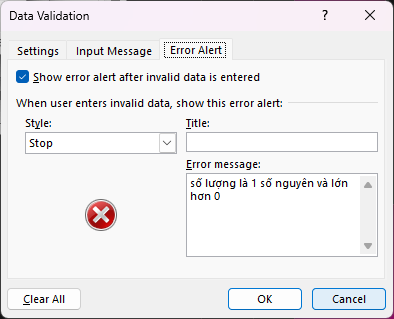
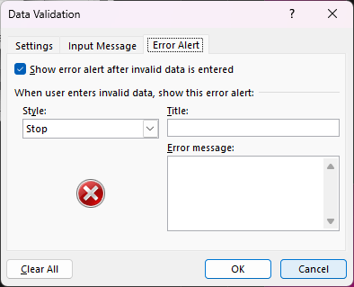
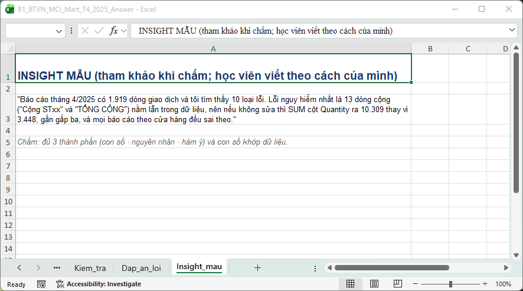

**Điểm: 8/10**

# Nhận xét bài tập về nhà Buổi 1 — Tô Thị Thu

| # | Việc | Kết quả | Điểm |
|---|---|---|---|
| 1 | Làm sạch cấu trúc | Đạt | 1/1 |
| 2 | Kiểu dữ liệu (Quantity, Order_Date) | Một phần | 0,5/1 |
| 3 | Excel Table + tên sheet | Đạt | 1/1 |
| 4 | Cột Revenue | Đạt | 1/1 |
| 5 | Kiem_tra!C5 + Pct_Share | Đạt | 1/1 |
| 6 | Data Validation | Một phần | 0,5/1 |
| 7 | Circle Invalid Data | Đạt | 1/1 |
| 8 | Insight | Insight 2/3 thành phần | 2/3 |
| | **Tổng** | | **8/10** |

Thang điểm: việc 1–7 mỗi việc 1 điểm, việc 8 (insight) 3 điểm, mỗi thành phần đạt (con số, nguyên nhân, hàm ý) được 1 điểm; việc 1–7 Đạt được trọn điểm, Một phần được một nửa, chưa làm được 0.

## Tài liệu để xem lại

Slide nằm trong file `Slide_B1_HocVien.pptx` (thư mục Buổi 1). Các file Excel để làm lại thao tác tính từ thư mục Buổi 1.

| Slide | Nội dung | Làm lại trên file |
|---|---|---|
| 29 (bước 4) | Chuyển Quantity và Order_Date dạng text thành số và ngày | `Practice/B1_MCI_Mart_Q1_2025_Dirty.xlsx` (làm lại bước 4); đối chiếu `Practice/B1_MCI_Mart_Q1_2025_Answer.xlsx`, sheet Sales |
| 27 | Data Validation, tab Error Alert | `Demo/B1_Demo_Table_Validation.xlsx`, sheet Sales |
| 40 | Tổng kết + câu insight (con số, nguyên nhân, hàm ý) | Sheet `Insight` trong file bạn nộp; câu mẫu ở `Homework/B1_BTVN_MCI_Mart_T4_2025_Answer.xlsx`, sheet Insight_mau |

## Đối soát nhanh với đáp án

Đáp án nằm ở `Homework/B1_BTVN_MCI_Mart_T4_2025_Answer.xlsx`, sheet `Kiem_tra`.

| Chỉ tiêu | Đáp án | File của bạn | Khớp? |
|---|---|---|---|
| Số dòng dữ liệu | 1.919 | 1.919 | ✔ |
| Tổng doanh thu | 296.965.000 | 296.965.000 | ✔ |
| Tổng Quantity | 3.448 | 3.448 | ✔ |
| Tổng Pct_Share | 100% | 100% | ✔ |
| Ô Quantity còn là text | 0 | 0 | ✔ |
| Ô Order_Date còn là text | 0 | **12** | ✘ |
| Thông báo lỗi Store_Code / Product_Code | Có | Chưa có | ✘ |
| Số dòng trong câu insight | 1.919 | 1948 | ✘ |

## Làm tốt

- **Bảng sạch, đúng 1.919 dòng.** Bạn bật **Total Row** để xem tổng nhanh (3.448 / 296.965.000 / 100%), con số đúng, mà cách tự kiểm tra này cũng rất đáng giữ.
- **`Kiem_tra`!C5 là công thức** `SUM(tblSales_T4[Revenue])`, Pct_Share chia cho `Kiem_tra!$C$5` và khóa `$` đúng chỗ.
- **Lỗi giá trị sửa đủ:** 10 ô Quantity text, 2 ô "ST5", 3 mã sản phẩm, 2 ô số âm.
- **Quantity có thông báo lỗi tiếng Việt.**

> **[CHỤP] NX01_total_row.png** · File: `Homework/Bai_nop/b1_btvn_to-thuF4U6MJ_ToThiThu.xlsx` · Sheet: `sales` · Vùng: cuối bảng (kéo xuống dòng 1920–1921) và cột F–K · Cần thấy: dòng Total với 3.448 (Quantity), 296.965.000 (Revenue), 100% (Pct_Share).

## Điểm cần lưu ý

### 1. Order_Date còn 12 ô là text (Việc 2: 0,5/1)

**Bạn đã làm:** Quantity chuyển xong, nhưng cột C của sheet `sales` còn 12 ô ngày là **text**: C21, C39, C308, C319, C514, C659, C909, C1192, C1366, C1494, C1614, C1733. Nhìn là biết: ô **căn trái**, hiện `05/04/2025` như một chuỗi chữ.
**Đáp án:** 12 ô là ngày thật, **căn phải** như các ô xung quanh (ví dụ C21 = 5/4/2025).
**Hậu quả:** Filter theo ngày hay Pivot theo ngày (Buổi 3) đều **bỏ sót 12 dòng** này, tổng theo tháng hụt mà Excel không báo gì.
**Chỗ tự bắt được:** sheet `Kiem_tra` của đáp án có dòng "Số ô Order_Date dạng text" phải bằng 0, file bạn ra 12.

**Cách sửa chắc tay nhất (không đảo ngày/tháng):**
1. Ở cột trống bên cạnh (ví dụ cột Q) dòng 21, gõ `=DATE(RIGHT(C21,4),MID(C21,4,2),LEFT(C21,2))`. Chuỗi `05/04/2025` tách thành năm 2025, tháng 04, ngày 05, ra **5 tháng 4**, khỏi sợ đảo ngày với tháng.
2. Kéo công thức cho đủ 12 ô (hoặc làm từng ô).
3. Copy kết quả → chọn lại ô gốc ở cột C → **Paste Special → Values** (Alt H V V).
4. Định dạng ô thành Short Date, xóa cột phụ.
5. Kiểm tra: ô phải căn phải; lọc cột C chỉ còn ngày trong tháng 4/2025.

**Cách khác:** chọn các ô → **Data → Text to Columns → Next → Next → Date: DMY → Finish**.
**Học lại:** **slide 29, bước 4** (`Slide_B1_HocVien.pptx`). Gợi ý trong lời giảng: "Với ngày dạng text, dùng Text to Columns với định dạng DMY, hoặc hàm DATEVALUE". Thực hành lại trên `Practice/B1_MCI_Mart_Q1_2025_Dirty.xlsx`.

> **[CHỤP] NX02a_ngay_text_bai_ban.png** · File: `Homework/Bai_nop/b1_btvn_to-thuF4U6MJ_ToThiThu.xlsx` · Sheet: `sales` · Vùng: A19:K23 · Cần thấy: ô C21 căn trái (text) giữa các ô căn phải; tô viền đỏ C21. Chọn C21 để thanh công thức hiện `05/04/2025`.

> **[CHỤP] NX02b_ngay_dap_an.png** · File: `Homework/B1_BTVN_MCI_Mart_T4_2025_Answer.xlsx` · Sheet: `Sales` · Vùng: A19:K23 · Cần thấy: ô C21 căn phải, là ngày thật; tô viền đỏ C21 để đối chiếu.

> **[CHỤP] NX03_loc_ngay_text.png** · File: `Homework/Bai_nop/b1_btvn_to-thuF4U6MJ_ToThiThu.xlsx` · Sheet: `sales` · Mở: bấm mũi tên Filter của cột Order_Date · Cần thấy: danh sách lọc có nhóm ngày (theo năm/tháng) **và** các mục text `05/04/2025`… nằm riêng bên dưới, chưa gộp vào nhóm ngày.

### 2. Data Validation thiếu thông báo lỗi ở hai cột (Việc 6: 0,5/1)

**Bạn đã làm:** Quantity có thông báo tiếng Việt ở tab **Error Alert**, còn Store_Code và Product_Code chưa.
**Đáp án:** cả ba cột có Error Alert tiếng Việt.
**Cách sửa:** Chọn cột → Data → Data Validation → tab **Error Alert** → tick **Show error alert after invalid data is entered** → Style **Stop** → nhập Title và Error message → OK. Ví dụ Store_Code: "Chỉ nhập mã có trong danh sách cửa hàng ST01–ST12".
**Học lại:** **slide 27** (`Slide_B1_HocVien.pptx`), làm trên `Demo/B1_Demo_Table_Validation.xlsx`, sheet Sales, cột Store_Code.

> **[CHỤP] NX04a_quantity_error_alert.png** · File: `Homework/Bai_nop/b1_btvn_to-thuF4U6MJ_ToThiThu.xlsx` · Sheet: `sales` · Mở: cột Quantity → Data Validation → tab **Error Alert** · Cần thấy: Title và Error message tiếng Việt của bạn.

> **[CHỤP] NX04b_store_error_alert_trong.png** · Cùng file, cột Store_Code → Data Validation → tab **Error Alert** · Cần thấy: chưa có Title và Error message.

## Câu insight

Câu của bạn: *"File Case có 1948 dòng, tôi tìm thấy 4 loại lỗi từ dữ liệu. Lỗi nguy hiểm nhất là số lượng là số âm, nếu không sửa thì mọi tính toán sau đó đều sai theo."*

| Thành phần | Nhận xét |
|---|---|
| **Con số** | **Chưa khớp.** Bảng sạch có **1.919** dòng, bạn ghi 1948 (file gốc chưa dọn có 1.946 dòng dưới tiêu đề, cũng chưa ra 1948). "4 loại lỗi" cũng cần đếm lại, sheet `Dap_an_loi` liệt kê 10 loại. |
| **Nguyên nhân** | **Có.** Số lượng âm là lỗi thật (2 ô), chọn đúng. |
| **Hàm ý** | **Có nhưng còn chung.** "Mọi tính toán đều sai" mà chưa nói sai bao nhiêu. |

**Lấy con số đúng:** Total Row bạn bật đã cho sẵn 1.919 dòng. Còn con số "trước/sau" thì bạn tự tính: giữ nguyên 2 ô âm thì tổng Quantity và doanh thu lệch bao nhiêu so với 3.448 và 296.965.000?
**Viết lại theo khung slide 40:** *"File có 1.919 dòng, tôi tìm thấy ___ loại lỗi. Lỗi nguy hiểm nhất là 2 ô số lượng âm, nên nếu không sửa thì tổng Quantity ra ___ thay vì 3.448 và doanh thu lệch ___ đồng."*
**Mức hiện tại:** Developing. Sửa số dòng và thêm độ lệch cụ thể là đủ ba thành phần.

> **[CHỤP] NX05_insight_mau.png** · File: `Homework/B1_BTVN_MCI_Mart_T4_2025_Answer.xlsx` · Sheet: `Insight_mau` · Vùng: A1:A5 · Cần thấy: câu mẫu (bật Wrap Text, kéo rộng cột A).

## Việc cần làm trước Buổi 2

- [ ] Đổi 12 ô Order_Date text thành ngày thật; kiểm tra lọc theo ngày không còn mục text.
- [ ] Điền tab **Error Alert** cho Store_Code và Product_Code.
- [ ] Viết lại câu insight với số dòng đúng 1.919 và độ lệch cụ thể.
