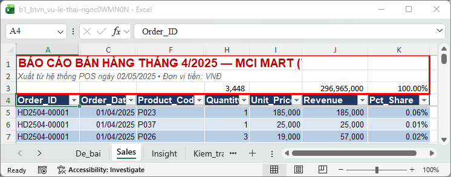
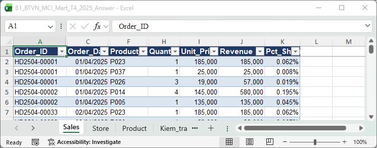
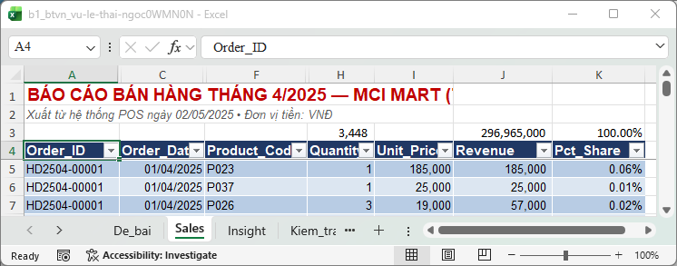
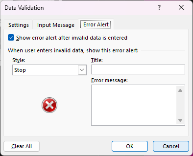
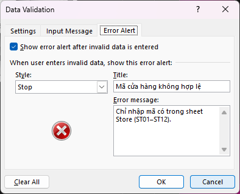

**Điểm: 7/10**

# Nhận xét bài tập về nhà Buổi 1 — Vũ Lê Thái Ngọc

| # | Việc | Kết quả | Điểm |
|---|---|---|---|
| 1 | Làm sạch cấu trúc | Một phần | 0,5/1 |
| 2 | Kiểu dữ liệu (Quantity, Order_Date) | Đạt | 1/1 |
| 3 | Excel Table + tên sheet | Đạt | 1/1 |
| 4 | Cột Revenue | Đạt | 1/1 |
| 5 | Kiem_tra!C5 + Pct_Share | Đạt | 1/1 |
| 6 | Data Validation | Một phần | 0,5/1 |
| 7 | Circle Invalid Data | Đạt | 1/1 |
| 8 | Insight | Insight 1/3 thành phần | 1/3 |
| | **Tổng** | | **7/10** |

Thang điểm: việc 1–7 mỗi việc 1 điểm, việc 8 (insight) 3 điểm, mỗi thành phần đạt (con số, nguyên nhân, hàm ý) được 1 điểm; việc 1–7 Đạt được trọn điểm, Một phần được một nửa, chưa làm được 0.

## Tài liệu để xem lại

Slide nằm trong file `Slide_B1_HocVien.pptx` (thư mục Buổi 1). Các file Excel để làm lại thao tác tính từ thư mục Buổi 1.

| Slide | Nội dung | Làm lại trên file |
|---|---|---|
| 25 | Good vs Bad Data Structure: tiêu đề cột ở dòng 1, không dòng thừa phía trên | `Practice/B1_MCI_Mart_Q1_2025_Dirty.xlsx` |
| 29 (bước 1) | Xóa dòng tiêu đề báo cáo, tiêu đề cột chỉ còn 1 dòng | `Practice/B1_MCI_Mart_Q1_2025_Dirty.xlsx`; đối chiếu `Practice/B1_MCI_Mart_Q1_2025_Answer.xlsx`, sheet Sales |
| 27 | Data Validation, tab Error Alert | `Demo/B1_Demo_Table_Validation.xlsx`, sheet Sales |
| 40 | Tổng kết + câu insight (con số, nguyên nhân, hàm ý) | Sheet `Insight` trong file bạn nộp; câu mẫu ở `Homework/B1_BTVN_MCI_Mart_T4_2025_Answer.xlsx`, sheet Insight_mau |

## Đối soát nhanh với đáp án

Đáp án nằm ở `Homework/B1_BTVN_MCI_Mart_T4_2025_Answer.xlsx`, sheet `Kiem_tra`.

| Chỉ tiêu | Đáp án | File của bạn | Khớp? |
|---|---|---|---|
| Số dòng dữ liệu | 1.919 | 1.919 | ✔ |
| Tổng doanh thu | 296.965.000 | 296.965.000 | ✔ |
| Tổng Quantity | 3.448 | 3.448 | ✔ |
| Tổng Pct_Share | 100% | 100% | ✔ |
| Tiêu đề cột nằm ở dòng | 1 | **4** | ✘ |
| Thông báo lỗi ở Store_Code / Product_Code / Quantity | Có | Chưa có | ✘ |
| Số dòng trong câu insight | 1.919 | 3448 (là tổng Quantity) | ✘ |

## Làm tốt

- **Dữ liệu làm sạch chuẩn:** 1.919 dòng, 10 ô Quantity và 12 ô ngày đổi đúng (không đảo ngày/tháng), 7 ô sai mã và số âm được sửa, không mất dòng nào. Mọi chỉ tiêu đối soát khớp.
- **`Kiem_tra`!C5 là công thức**, Pct_Share chia cho `Kiem_tra!$C$5` và cộng lại đúng 100%.
- **List lấy thẳng từ sheet Store và Product** như đề yêu cầu, nên danh mục gốc đổi thì danh sách đổi theo.

## Điểm cần lưu ý

### 1. Phía trên bảng còn tiêu đề báo cáo (Việc 1: 0,5/1)

**Bạn đã làm:** sheet `Sales` còn **dòng 1–2** là tiêu đề báo cáo, **dòng 3** là các công thức `SUBTOTAL`, tiêu đề cột và Table mới bắt đầu từ **dòng 4**.
**Đề yêu cầu:** "1 dòng tiêu đề ở dòng 1, ngay bên dưới là dữ liệu".
**Đáp án:** tiêu đề cột `Order_ID | Line_No | Order_Date | …` ở dòng 1, dòng dữ liệu đầu tiên ở dòng 2.
**Hậu quả:** Pivot ở Buổi 3 và Power Query ở Buổi 4 đều đọc từ ô đầu tiên, trên bảng còn chữ hay công thức thì lần nào cũng phải chỉnh tay. Dòng `SUBTOTAL` ở dòng 3 lại dễ bị tính là dữ liệu khi chọn cả vùng.
**Lưu ý:** bản thân Table của bạn đã đúng và sạch, chỉ cần xóa 3 dòng trên cùng.

**Cách sửa:**
1. Chọn số dòng **1–3** (kéo trên cột số dòng) → chuột phải → **Delete**.
2. Kiểm tra: bấm một ô trong bảng, nhấn Ctrl + ↑ phải dừng ở dòng 1 (tiêu đề cột).
3. Chọn ô Order_ID đầu tiên → Ctrl + Shift + ↓ → Status Bar Count = **1.919**.
4. Xem lại công thức Revenue/Pct_Share sau khi xóa. Table tự cập nhật, chỉ công thức ngoài Table đang trỏ vào dòng 1–3 mới báo `#REF!`.

**Học lại:** **slide 25** (Good vs Bad Data Structure) và **slide 29, bước 1** (`Slide_B1_HocVien.pptx`), thực hành lại trên `Practice/B1_MCI_Mart_Q1_2025_Dirty.xlsx`.

> **[CHỤP] NX01a_dau_sheet_ban.png** · File: `Homework/Bai_nop/b1_btvn_vu-le-thai-ngoc0WMN0N.xlsx` · Sheet: `Sales` · Vùng: A1:K8 · Cần thấy: dòng 1–2 tiêu đề báo cáo, dòng 3 công thức SUBTOTAL, dòng 4 tiêu đề cột; tô viền đỏ dòng 1–3.

> **[CHỤP] NX01b_dau_sheet_dap_an.png** · File: `Homework/B1_BTVN_MCI_Mart_T4_2025_Answer.xlsx` · Sheet: `Sales` · Vùng: A1:K8 · Cần thấy: tiêu đề cột ở dòng 1, dữ liệu từ dòng 2.

> **[CHỤP] NX02_ctrl_len_dung_o_dong_4.png** · File: `Homework/Bai_nop/b1_btvn_vu-le-thai-ngoc0WMN0N.xlsx` · Sheet: `Sales` · Cần thấy: con trỏ ở ô A4 (tiêu đề cột) sau khi bấm một ô dữ liệu rồi Ctrl + ↑; thấy rõ 3 dòng phía trên A4.

### 2. Data Validation chưa có thông báo lỗi (Việc 6: 0,5/1)

**Bạn đã làm:** nguồn List đúng, Quantity > 0 đúng, nhưng tab **Error Alert** của cả ba cột (Store_Code, Product_Code, Quantity) còn trống.
**Đáp án:** cả ba cột có Title và Error message tiếng Việt, Style Stop.
**Hậu quả:** nhập sai thì hiện cửa sổ lỗi mặc định bằng tiếng Anh, người nhập không biết sửa thế nào.

**Cách sửa:** chọn cột → Data → Data Validation → tab **Error Alert** → tick **Show error alert after invalid data is entered** → Style **Stop** → nhập Title và Error message → OK. Gợi ý:
- Store_Code: "Chỉ nhập mã trong danh sách cửa hàng ST01–ST12".
- Product_Code: "Chỉ nhập mã sản phẩm có trong sheet Product".
- Quantity: "Chỉ nhập số nguyên lớn hơn 0".

**Học lại:** **slide 27** (`Slide_B1_HocVien.pptx`), làm trên `Demo/B1_Demo_Table_Validation.xlsx`, sheet Sales.

> **[CHỤP] NX03a_error_alert_trong.png** · File: `Homework/Bai_nop/b1_btvn_vu-le-thai-ngoc0WMN0N.xlsx` · Sheet: `Sales` · Mở: cột Store_Code → Data Validation → tab **Error Alert** · Cần thấy: Title và Error message trống.

> **[CHỤP] NX03b_error_alert_dap_an.png** · File: `Homework/B1_BTVN_MCI_Mart_T4_2025_Answer.xlsx` · Sheet: `Sales` · Mở: cột Store_Code → Data Validation → tab **Error Alert** · Cần thấy: ô đã tick, Style Stop, Title và Error message tiếng Việt.

## Câu insight

Câu của bạn: *"File case có 3448 dòng, tôi tìm thấy 3 loại lỗi dữ liệu. Lỗi nguy hiểm nhất là lỗi dữ liệu ở cột quantity, nên nếu không sửa thì có thể dẫn đến sai số liệu tổng doanh thu của tháng 4/2025"*

| Thành phần | Nhận xét |
|---|---|
| **Con số** | **Chưa đúng.** 3.448 là **tổng Quantity**, số dòng dữ liệu là **1.919**. "3 loại lỗi" cũng cần đếm lại (`Dap_an_loi` liệt kê 10 loại). |
| **Nguyên nhân** | **Chưa rõ.** Bạn chỉ đúng cột Quantity nhưng chưa nói lỗi gì. Hai lỗi tác động khác nhau: Quantity **text** thì SUM bỏ qua, Quantity **âm** thì kéo sai cả Revenue. |
| **Hàm ý** | **Có, đúng hướng** (sai tổng doanh thu), chỉ thiếu độ lệch. |

**Viết lại theo khung slide 40** (`Slide_B1_HocVien.pptx`): chọn một lỗi, nêu số ô và con số trước/sau. Ví dụ: *"File có 1.919 dòng, tôi tìm thấy ___ loại lỗi. Lỗi nguy hiểm nhất là 2 ô Quantity âm ở cột Quantity, nên nếu không sửa thì tổng Quantity và Revenue bị trừ thay vì cộng, tổng ra ___ thay vì 3.448 / 296.965.000."*
Câu mẫu (sheet Insight_mau): *"… 13 dòng cộng nằm lẫn trong dữ liệu, nên nếu không sửa thì SUM cột Quantity ra 10.309 thay vì 3.448 …"*
**Mức hiện tại:** Developing.

> **[CHỤP] NX04_insight_mau.png** · File: `Homework/B1_BTVN_MCI_Mart_T4_2025_Answer.xlsx` · Sheet: `Insight_mau` · Vùng: A1:A5 · Cần thấy: câu mẫu (bật Wrap Text, kéo rộng cột A).

## Việc cần làm trước Buổi 2

- [ ] Xóa dòng 1–3 phía trên bảng để tiêu đề cột nằm ở dòng 1; kiểm tra Count = 1.919.
- [ ] Điền tab **Error Alert** cho cả ba cột.
- [ ] Viết lại câu insight: số dòng 1.919, một lỗi cụ thể, hậu quả bằng con số.
