**Điểm: 6/10**

# Nhận xét bài tập về nhà Buổi 1 — Vũ Thị Thanh Thủy

| # | Việc | Kết quả | Điểm |
|---|---|---|---|
| 1 | Làm sạch cấu trúc | Đạt | 1/1 |
| 2 | Kiểu dữ liệu (Quantity, Order_Date) | Một phần | 0,5/1 |
| 3 | Excel Table + tên sheet | Một phần | 0,5/1 |
| 4 | Cột Revenue | Đạt | 1/1 |
| 5 | Kiem_tra!C5 + Pct_Share | Một phần | 0,5/1 |
| 6 | Data Validation | Một phần | 0,5/1 |
| 7 | Circle Invalid Data | Đạt | 1/1 |
| 8 | Insight | Insight 1/3 thành phần | 1/3 |
| | **Tổng** | | **6/10** |

Thang điểm: việc 1–7 mỗi việc 1 điểm, việc 8 (insight) 3 điểm, mỗi thành phần đạt (con số, nguyên nhân, hàm ý) được 1 điểm; việc 1–7 Đạt được trọn điểm, Một phần được một nửa, chưa làm được 0.

## Tài liệu để xem lại

Slide nằm trong file `Slide_B1_HocVien.pptx` (thư mục Buổi 1). Các file Excel để làm lại thao tác tính từ thư mục Buổi 1.

| Slide | Nội dung | Làm lại trên file |
|---|---|---|
| 29 (bước 4) | Chuyển Quantity và Order_Date dạng text thành số và ngày | `Practice/B1_MCI_Mart_Q1_2025_Dirty.xlsx`; đối chiếu `Practice/B1_MCI_Mart_Q1_2025_Answer.xlsx`, sheet Sales |
| 26 | Excel Table: Ctrl + T, đặt Table Name | `Demo/B1_Demo_Table_Validation.xlsx`, sheet Sales |
| 19 | Tham chiếu `$` (Pct_Share chia cho ô tổng) | `Demo/B1_Demo_PctShare.xlsx`, sheet Demo_PctShare |
| 30 (bước 2) | Ô tổng doanh thu + Pct_Share; kiểm tra tổng | `Practice/B1_MCI_Mart_Q1_2025_Answer.xlsx`, sheet Kiem_tra |
| 27 | Data Validation, tab Error Alert | `Demo/B1_Demo_Table_Validation.xlsx`, sheet Sales |
| 28 | Circle Invalid Data | `Demo/B1_Demo_Table_Validation.xlsx`, sheet Sales |
| 40 | Tổng kết + câu insight (con số, nguyên nhân, hàm ý) | Sheet `Insight` trong file bạn nộp; câu mẫu ở `Homework/B1_BTVN_MCI_Mart_T4_2025_Answer.xlsx`, sheet Insight_mau |

## Đối soát nhanh với đáp án

Đáp án nằm ở `Homework/B1_BTVN_MCI_Mart_T4_2025_Answer.xlsx`, sheet `Kiem_tra`.

| Chỉ tiêu | Đáp án | File của bạn | Khớp? |
|---|---|---|---|
| Số dòng dữ liệu | 1.919 | 1.919 | ✔ |
| Tổng doanh thu | 296.965.000 | 296.965.000 | ✔ |
| Tổng Quantity | 3.448 | **3.441** (thiếu 7) | ✘ |
| Tổng Pct_Share | 100% | 100% | ✔ |
| Ô Quantity còn là text | 0 | **4** | ✘ |
| Ô Order_Date còn là text | 0 | **7** | ✘ |
| Tên Table / tên sheet | `tblSales_T4` / `Sales` | `tbsale_T4` / `sale` | ✘ |
| Ô tổng doanh thu | `Kiem_tra!C5` | `kiểm_tra`!C2 (C5 là tổng Pct_Share) | ✘ |
| Circle Invalid Data | Không còn ô khoanh | Còn 4 ô Quantity | ✘ |

## Làm tốt

- **Cấu trúc sạch:** tiêu đề ở dòng 1, đúng 1.919 dòng dữ liệu, dòng "Cửa hàng", "Cộng", "TỔNG CỘNG", dòng lặp tiêu đề và dòng trống đều đã dọn hết.
- **Revenue và Pct_Share là công thức**, Pct_Share khóa `$` đúng, cộng lại 100%. 7 ô sai mã và số âm cũng được sửa đúng.
- **Những ô đã đổi kiểu** (6 ô Quantity, 5 ô ngày) đều đúng, ngày không bị đảo với tháng.
- **Circle Invalid Data đã chỉ đúng ô còn sót:** vòng đỏ trong bài bạn chính là 4 ô Quantity text chưa đổi.

## Điểm cần lưu ý

### 1. Kiểu dữ liệu chưa xong, các số đối soát lệch theo (Việc 2: 0,5/1)

**Bạn đã làm:**
- Quantity còn **4 ô text**: sheet `sale`, H584, H1139, H1505, H1570.
- Order_Date còn **7 ô text**: C21, C308, C319, C514, C659, C909, C1366.

**Đáp án:** 11 ô này là số và ngày thật, đều căn phải.
**Hậu quả, ngay trong bài của bạn:**
- Tổng Quantity ra **3.441** thay vì **3.448**, hụt 7 vì SUM bỏ qua các ô text.
- Circle Invalid Data vẫn khoanh **4 ô Quantity**, vì text không qua được quy tắc "Whole number > 0".
- Lọc hay Pivot theo ngày (Buổi 3) sẽ sót 7 dòng.

**Cách sửa:**
1. *Quantity:* bấm ô có **tam giác xanh** ở góc → bấm biểu tượng cảnh báo → **Convert to Number** (hoặc chọn 4 ô rồi làm một lần).
2. *Order_Date:* ở ô trống bên cạnh gõ `=DATE(RIGHT(C21,4),MID(C21,4,2),LEFT(C21,2))`, kéo cho 7 ô, copy → chọn lại ô gốc → **Paste Special → Values** (Alt H V V); hoặc **Data → Text to Columns → Date: DMY**. Ngày `05/04` phải ra 5 tháng 4.
3. *Để khỏi sót:* thêm tạm một cột `=ISTEXT(H2)` (và `=ISTEXT(C2)`), lọc TRUE, sửa đến khi hết dòng, rồi xóa cột tạm.
4. Kiểm tra: tổng Quantity = 3.448; Circle Invalid Data không còn khoanh ô nào.

**Học lại:** **slide 29, bước 4** (`Slide_B1_HocVien.pptx`), thực hành lại trên `Practice/B1_MCI_Mart_Q1_2025_Dirty.xlsx`.

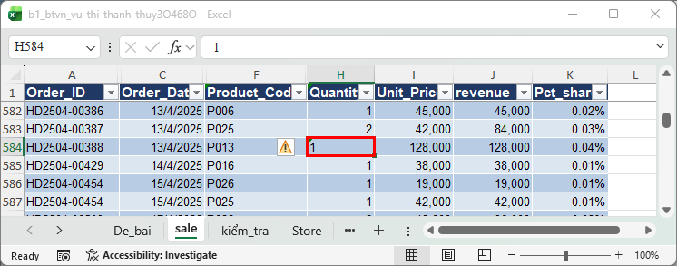
> **[CHỤP] NX01a_quantity_text_bai_ban.png** · File: `Homework/Bai_nop/b1_btvn_vu-thi-thanh-thuy3O468O.xlsx` · Sheet: `sale` · Vùng: F582:K586 (quanh H584) · Cần thấy: H584 có tam giác xanh ở góc và căn trái; viền đỏ H584.

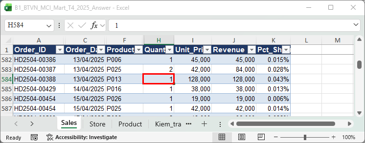
> **[CHỤP] NX01b_quantity_dap_an.png** · File: `Homework/B1_BTVN_MCI_Mart_T4_2025_Answer.xlsx` · Sheet: `Sales` · Vùng: F582:K586 · Cần thấy: Quantity căn phải, không có tam giác xanh; viền đỏ H584.

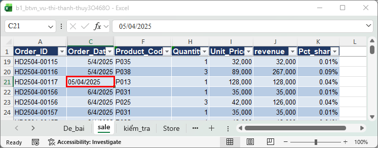
> **[CHỤP] NX02a_ngay_text_bai_ban.png** · File: `Homework/Bai_nop/b1_btvn_vu-thi-thanh-thuy3O468O.xlsx` · Sheet: `sale` · Vùng: A19:K23 · Cần thấy: C21 căn trái (text) giữa các ô ngày căn phải; viền đỏ C21.

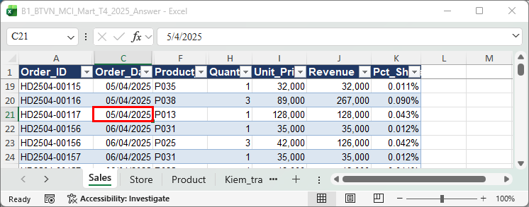
> **[CHỤP] NX02b_ngay_dap_an.png** · File: `Homework/B1_BTVN_MCI_Mart_T4_2025_Answer.xlsx` · Sheet: `Sales` · Vùng: A19:K23 · Cần thấy: C21 căn phải, là ngày thật; viền đỏ C21.

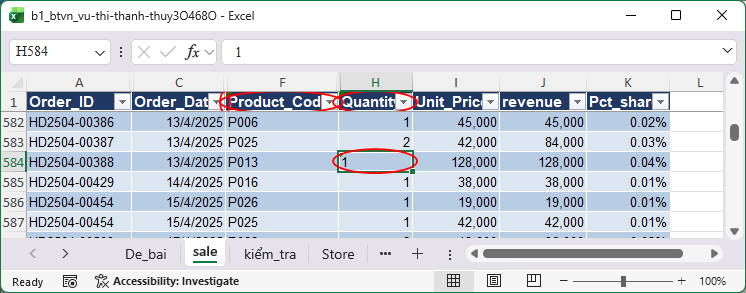
> **[CHỤP] NX03_circle_con_4_o.png** · File: `Homework/Bai_nop/b1_btvn_vu-thi-thanh-thuy3O468O.xlsx` · Sheet: `sale` · Mở: Data → Data Validation ▾ → **Circle Invalid Data**, cuộn tới H584 · Cần thấy: vòng đỏ quanh H584 (chụp thêm H1139, H1505, H1570 nếu cùng khung được, hoặc ghép 4 ảnh nhỏ).

### 2. Tên bảng và tên sheet khác đề (Việc 3: 0,5/1)

**Bạn đã làm:** Table tên `tbsale_T4`; sheet tên `sale`.
**Đề yêu cầu:** Table `tblSales_T4`; sheet `Sales`; các cột `Revenue`, `Pct_Share` đúng tên.
**Hậu quả:** các buổi sau viết công thức kiểu `tblSales_T4[Revenue]`, rồi nối sang `tblStore`, `tblProduct`. Tên khác đề thì công thức mẫu, bài đối soát và Pivot dựng sẵn đều không chạy trên file của bạn, phải sửa tay từng chỗ.

**Cách sửa:**
1. Bấm vào một ô trong bảng → tab **Table Design** → ô **Table Name** ở góc trái → gõ `tblSales_T4` → Enter.
2. Nhấp đúp tên sheet `sale` → gõ `Sales` → Enter.
3. Kiểm tra tên cột đúng `Revenue`, `Pct_Share` (có gạch dưới, phân biệt chữ hoa).
4. Cách đặt: "tbl" + tên nội dung + hậu tố kỳ, ra `tblSales_T4`.

**Học lại:** **slide 26** (`Slide_B1_HocVien.pptx`), làm trên `Demo/B1_Demo_Table_Validation.xlsx`, sheet Sales: "Table Design → Table Name, đặt là tblSales".

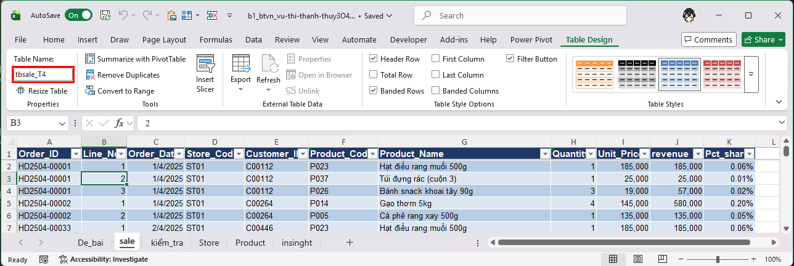
> **[CHỤP] NX04a_table_name_ban.png** · File: `Homework/Bai_nop/b1_btvn_vu-thi-thanh-thuy3O468O.xlsx` · Sheet: `sale` · Mở: bấm một ô trong bảng → tab Table Design · Cần thấy: ô Table Name = `tbsale_T4` (khoanh đỏ) và thanh tên sheet phía dưới ghi `sale`.

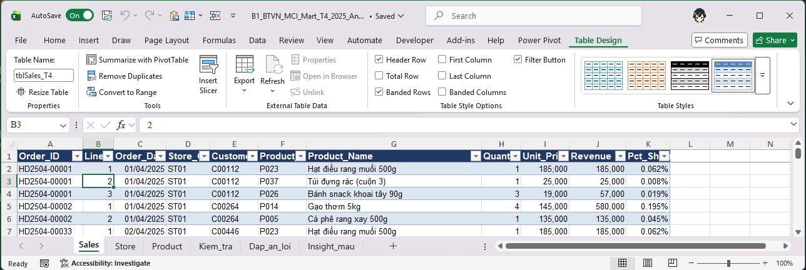
> **[CHỤP] NX04b_table_name_dap_an.png** · File: `Homework/B1_BTVN_MCI_Mart_T4_2025_Answer.xlsx` · Sheet: `Sales` · Mở: bấm một ô trong bảng → tab Table Design · Cần thấy: Table Name = `tblSales_T4`, thanh sheet ghi `Sales`.

### 3. Sheet `kiểm_tra`: vị trí ô tổng khác đề, các ô kiểm tra là số 0 gõ tay (Việc 5: 0,5/1)

**Bạn đã làm:**
- Tổng doanh thu đặt ở **C2** (Pct_Share chia cho `$C$2`), còn **C5** lại là tổng Pct_Share.
- Các ô **C6:C9** là số 0 **gõ tay**.

**Đề yêu cầu / đáp án:** `Kiem_tra!C5` = tổng doanh thu (`=SUM(tblSales_T4[Revenue])`); các dòng đối soát là **công thức** (xem sheet `Kiem_tra` trong file đáp án, dòng 9–13).
**Hậu quả:** lúc nộp bài vẫn còn 4 Quantity text và 7 ngày text, sheet lại hiện 0. Bảng đối soát chỉ có ích khi **tự bắt được lỗi**, còn số gõ tay thì lúc nào cũng xanh. Circle Invalid Data đang khoanh ô sót, bảng kiểm tra bên cạnh vẫn báo "không lỗi".

**Cách sửa:**
1. Ô tổng doanh thu chuyển về **C5**: `=SUM(tblSales_T4[Revenue])`; cột Pct_Share: `=[@Revenue]/Kiem_tra!$C$5`.
2. Đổi tên sheet thành `Kiem_tra` (không dấu, đúng đề).
3. Thay số 0 bằng công thức, ví dụ:
   - Quantity còn text: `=SUMPRODUCT(--ISTEXT(tblSales_T4[Quantity]))`
   - Order_Date còn text: `=SUMPRODUCT(--ISTEXT(tblSales_T4[Order_Date]))`
   - Quantity ≤ 0: `=COUNTIF(tblSales_T4[Quantity],"<=0")`
4. Sửa dữ liệu ở mục 1 xong, các ô này phải về 0 **bằng công thức**.

**Học lại:** **slide 19** (`Demo/B1_Demo_PctShare.xlsx`, sheet Demo_PctShare) và **slide 30, bước 2** (đối chiếu `Practice/B1_MCI_Mart_Q1_2025_Answer.xlsx`, sheet Kiem_tra).

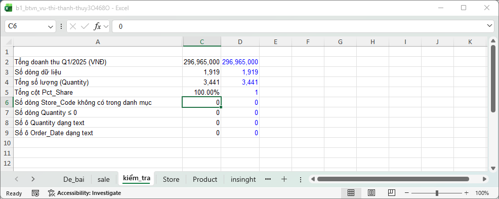
> **[CHỤP] NX05a_kiem_tra_ban.png** · File: `Homework/Bai_nop/b1_btvn_vu-thi-thanh-thuy3O468O.xlsx` · Sheet: `kiểm_tra` · Vùng: A1:E12 · Cần thấy: C2 (tổng doanh thu), C5 (tổng Pct_Share), C6:C9 là số 0; chọn một ô C6 để thanh công thức hiện số gõ tay, không phải công thức.

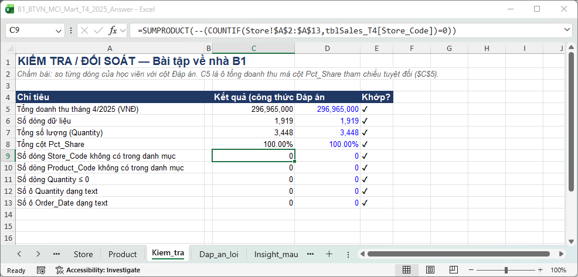
> **[CHỤP] NX05b_kiem_tra_dap_an.png** · File: `Homework/B1_BTVN_MCI_Mart_T4_2025_Answer.xlsx` · Sheet: `Kiem_tra` · Vùng: A1:E13 · Cần thấy: C5 = tổng doanh thu, các dòng C9:C13 là công thức, cột E có dấu ✔.

### 4. Data Validation chưa có thông báo lỗi (Việc 6: 0,5/1)

**Bạn đã làm:** tab **Error Alert** của Store_Code, Product_Code và Quantity còn trống.
**Đáp án:** cả ba cột có Title và Error message tiếng Việt, Style Stop.
**Cách sửa:** chọn cột → Data → Data Validation → tab **Error Alert** → tick **Show error alert after invalid data is entered** → Style **Stop** → nhập Title và Error message → OK.
**Học lại:** **slide 27** (`Slide_B1_HocVien.pptx`), làm trên `Demo/B1_Demo_Table_Validation.xlsx`, sheet Sales.

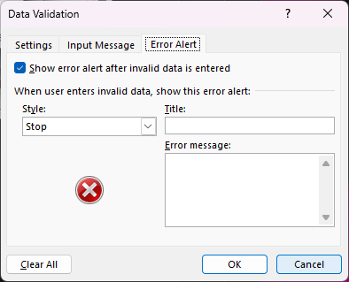
> **[CHỤP] NX06a_error_alert_trong.png** · File: `Homework/Bai_nop/b1_btvn_vu-thi-thanh-thuy3O468O.xlsx` · Sheet: `sale` · Mở: cột Quantity → Data Validation → tab **Error Alert** · Cần thấy: Title và Error message trống.

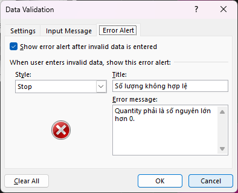
> **[CHỤP] NX06b_error_alert_dap_an.png** · File: `Homework/B1_BTVN_MCI_Mart_T4_2025_Answer.xlsx` · Sheet: `Sales` · Mở: cột Quantity → Data Validation → tab **Error Alert** · Cần thấy: ô đã tick, Style Stop, Title và Error message tiếng Việt.

## Câu insight

Câu của bạn: *"file có 1920 dòng, tôi tìm thấy 2 lỗi dữ liệu. Lỗi nguy hiểm nhất là sai định dữ liệu bị sai định dạng . Nếu không sửa chữa sẽ làm sai giá trị trang tính."*

| Thành phần | Nhận xét |
|---|---|
| **Con số** | **Chưa khớp.** 1920 là đã tính cả dòng tiêu đề, dòng dữ liệu là **1.919**. "2 lỗi" cũng cần đếm lại (`Dap_an_loi` liệt kê 10 loại). |
| **Nguyên nhân** | **Đúng hướng nhưng còn chung.** "Sai định dạng" là lỗi thật (số và ngày dạng text), chỉ chưa nói cột nào, bao nhiêu ô. |
| **Hàm ý** | **Chưa cụ thể.** "Sai giá trị trang tính" mà chưa chỉ ra con số nào sai. |

**Con số nằm ngay trong file bạn:** còn 4 ô Quantity text thì **tổng Quantity ra 3.441, đúng phải là 3.448** (hụt 7).
**Viết lại theo khung slide 40** (`Slide_B1_HocVien.pptx`): *"File có 1.919 dòng, tôi tìm thấy ___ loại lỗi. Lỗi nguy hiểm nhất là Quantity lưu dạng text (4 ô), nên nếu không sửa thì tổng Quantity ra 3.441 thay vì 3.448 và Circle Invalid Data vẫn khoanh ô sai."*
Câu mẫu (sheet Insight_mau): *"… 13 dòng cộng nằm lẫn trong dữ liệu, nên nếu không sửa thì SUM cột Quantity ra 10.309 thay vì 3.448 …"*
**Mức hiện tại:** Developing.

> **[CHỤP] NX07_insight_mau.png** · File: `Homework/B1_BTVN_MCI_Mart_T4_2025_Answer.xlsx` · Sheet: `Insight_mau` · Vùng: A1:A5 · Cần thấy: câu mẫu (bật Wrap Text, kéo rộng cột A).

## Việc cần làm trước Buổi 2

- [ ] Đổi 4 ô Quantity text và 7 ô Order_Date text; tổng Quantity phải ra 3.448; Circle Invalid Data không còn khoanh ô nào.
- [ ] Đổi tên Table thành `tblSales_T4`, tên sheet thành `Sales`.
- [ ] Chuyển ô tổng doanh thu về `Kiem_tra!C5`; thay số 0 gõ tay bằng công thức.
- [ ] Điền tab **Error Alert** cho ba cột.
- [ ] Viết lại câu insight bằng con số trong file của bạn (3.441 so với 3.448).
